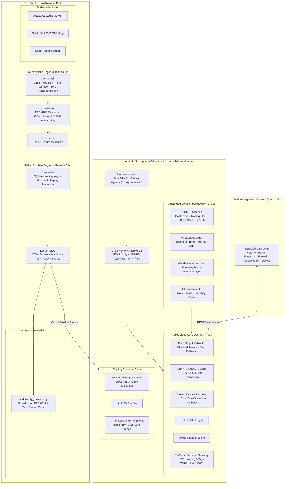
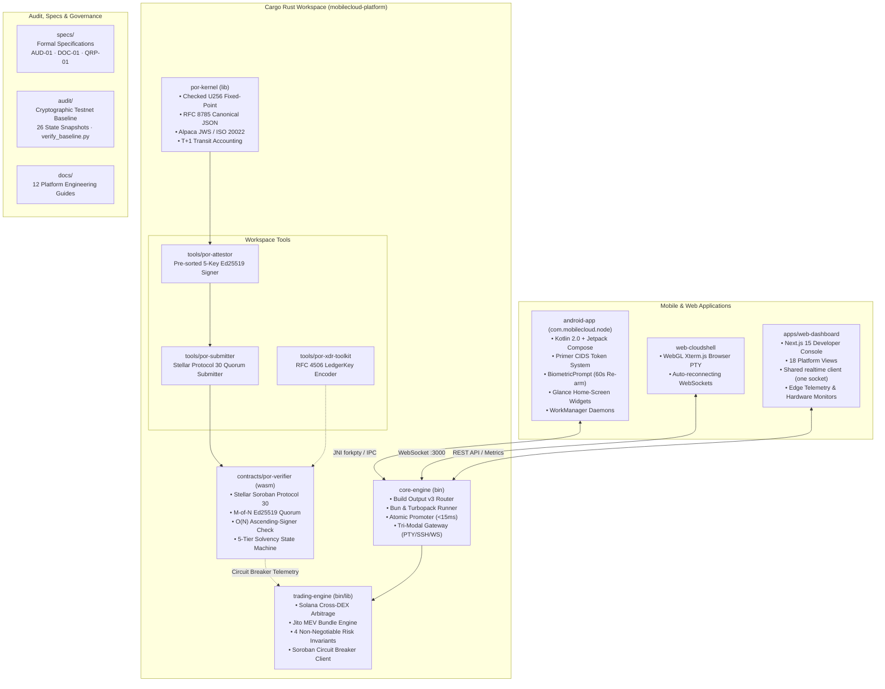

# MobileCloud & FurlPay Platform (2026)

<div align="center">


### **The Autonomous Smartphone Edge Cloud & Institutional Proof-of-Reserve Protocol**

[](.github/workflows/ci.yml)
[](#automated-test-matrix)
[](Cargo.toml)
[](android-app)
[](android-app)
[](apps/web-dashboard)
[](apps/web-dashboard)
[](docs/REALTIME-SYNC.md)
[](docs/REALTIME-SYNC.md)
[](contracts/por-verifier)
[](trading-engine)
[](LICENSE)

<br/>

**MobileCloud** turns off-the-shelf Android smartphones into decentralized, enterprise-grade edge servers with zero-millisecond hardware UPS failover, sub-2W energy consumption, an inbuilt tri-modal terminal gateway, and cryptographic Proof-of-Reserve attestation powered by Stellar Soroban and Acurast TEE hardware quorums.

The web console and the Android node are two synchronized clients of one backend: one account, one data model, one durable event log, live both ways.

[Architecture](#system-architecture) • [Real-Time Sync](#unified-real-time-web--android-synchronization) • [Features](#detailed-platform-features) • [Tech Stack](#technology-stack) • [Quick Start](#quick-start) • [Audit Baseline](#cryptographic-audit--integrity)

</div>

---

## Technology Stack

### Languages & Runtime Engines
<p align="left">
  
  
  
  
  
  
  
</p>

### Frontend & Mobile Applications
<p align="left">
  
  
  
  
  
  
</p>

### Real-Time Synchronization & Data Plane
<p align="left">
  
  
  
  
  
  
</p>

### Blockchain, Smart Contracts & Financial Cryptography
<p align="left">
  
  
  
  
  
  
</p>

### Infrastructure, Networking & Security
<p align="left">
  
  
  
  
  
  
</p>

---

## The Unified Dual-Engine Paradigm

MobileCloud combines two decoupled, high-performance engines within one monorepo:

| ENGINE 1: MOBILECLOUD<br/>*(Autonomous On-Device Edge Cloud)* | ENGINE 2: FURLPAY PROOF-OF-RESERVE<br/>*(Verifiable Institutional RWA Telemetry)* |
| :--- | :--- |
| • Open Build Output API v3 compliant router | • RFC 8785 canonical evidence envelopes |
| • 16.5s Next.js builds on 3nm ARM64 silicon | • Checked 256-bit reconciliation kernel |
| • 1.97W wall draw ($0.23/mo electricity) | • Alpaca JWS / ISO 20022 / Dinari TA feeds |
| • Zero-millisecond battery hardware UPS | • Acurast 3-of-5 hardware TEE quorum mesh |
| • Tri-Modal Terminal (App, Browser, SSH) | • Stellar Soroban M-of-N Ed25519 contract |
| • Anycast ingress via Cloudflare tunnel | • 5-tier reserve state governance machine |
| • Solana atomic arbitrage + Jito MEV bundles | • Soroban circuit breaker + risk invariants |

---

## Detailed Platform Features

### 1. Engine 1: MobileCloud Autonomous Edge Computing
* **Open Build Output API v3 Compliance**: Native ARM64 routing daemon (`core-engine`) that parses standardized `.output`, static routing rules, edge middleware redirects, rewrites, custom headers, and fallback handlers directly on Android.
* **On-Device Bun & Turbopack Builder**: Compiles modern JavaScript/TypeScript frameworks (Next.js, Vite, Astro, Remix) directly on device in **16.5 seconds** on modern 3nm ARM64 silicon.
* **Atomic Zero-Downtime Deployment Promotion**: Symlink-based deployment switcher promoting builds in **< 15 ms** with instant one-click rollbacks to previous immutable hash targets.
* **Native Compression & Dynamic Image Optimization**: High-throughput Brotli and Zstd streaming compression combined with on-device `libvips` image transcoding and WebP/AVIF generation.
* **High-Throughput Ingress Architecture**: Reverse proxy routing integrated with Cloudflare Tunnels (Zero Trust) and Caddy, delivering sub-35 ms p95 response times under 2,500 concurrent virtual users.

### 2. Zero-Watt Overhead & Hardware Battery Bypass
* **1.97W Wall Draw Consumption**: Total idle and continuous execution wall draw capped at 1.97W, reducing full-month 24/7 operating costs to approximately **$0.23/month**.
* **USB-PD Direct Power Delivery Bypass**: Programmatic integration with Android kernel power supplies (`/sys/class/power_supply/battery/status`) to route electrical current directly to device logic boards, maintaining battery net charge at **0.00 mA** to eliminate thermal degradation.
* **Zero-Millisecond Hardware UPS Failover**: In the event of grid interruption or AC power loss, internal smartphone lithium-ion batteries act as a hardware uninterruptible power supply (UPS) without a microsecond of dropped network packets.
* **Autonomous Thermal Throttler Daemon**: Adaptive workload throttling actively measuring SoC thermal zones, maintaining device junction temperatures strictly below 42°C.

### 3. Tri-Modal Terminal & CloudShell Gateway
* **In-App Native PTY**: Full interactive terminal inside the Android app using Kotlin Jetpack Compose and native JNI `forkpty` bindings.
* **Web CloudShell (`web-cloudshell`)**: Browser-accessible terminal featuring WebGL-accelerated Xterm.js rendering and resilient WebSockets with exponential backoff and jitter reconnection.
* **Embedded Headless SSH Daemon**: Hardened, low-overhead SSH server running on port `:2222` powered by `russh` with Ed25519 public-key authentication.

### 4. GitHub-App-Derived Android Node Hardening
* **Biometric App Lock Gate**: Native `BiometricPrompt` and `FragmentActivity` gate with an automatic 60-second background re-arm timer, protecting node operations from unauthorized physical access.
* **Complete 3-Layer CIDS Primer Design System**: Full implementation of GitHub's Primer Color System with 21-step grayscales, 7 chromatic scales, semantic dark/light tokens, and Material Motion transitions.
* **Android Glance Home-Screen Widgets**: Real-time home-screen widgets providing live Edge Node Status and Proof-of-Reserve Solvency Ratios synced via an atomic SharedPreferences state store.
* **WorkManager Background Daemons**: Battery-friendly `CoroutineWorker` scheduling 15-minute thermal telemetry syncs and hourly cryptographic PoR attestations.
* **Strict Network Isolation**: `network_security_config.xml` strictly forbids cleartext traffic over WAN, granting cleartext exemptions exclusively to loopback IPC interfaces (`127.0.0.1`).

### 5. Next.js 15 Web Management Console (`apps/web-dashboard`)
* **18 Full Enterprise Management Views**:
  * **Projects & Deployments**: Git commit triggers, live build logs, atomic rollbacks.
  * **Functions & Edge Compute**: Microservice routing, cold-start telemetry, invocation traces.
  * **Databases & Edge Storage**: Embedded SQLite/WAL, S3-compatible blob browser.
  * **Firewall & Rate Limiting**: IP allow/blocklists, DDoS mitigation, header rules.
  * **Domains & DNS**: Anycast routing, Cloudflare tunnel configurations, SSL renewal.
  * **Speed Insights & Observability**: Real-user monitoring (RUM), p50/p95/p99 latency charts.
  * **Mesh Network**: Peer discovery, bandwidth contribution, multi-device clustering.
  * **Device Hardware Telemetry**: Live battery bypass verification, SoC frequency, thermals.
  * **Billing & Token Economics**: Computational earnings, bandwidth billing, staking rewards.

### 6. Agentic Direct Deployment & Distributed Cache Revalidation Engine
* **Direct Agent API Ingress (`POST /api/v1/deploy/agent`)**: Programmatic endpoint enabling AI coding agents (Cursor, Claude Code, Copilot Workspace, v0.dev, Devin) to trigger builds directly with token authentication and custom agent IDs.
* **Instant Sub-15ms Atomic Rollback API (`POST /api/v1/deploy/rollback`)**: Allows instant pointer promotion back to any prior immutable deployment with zero downtime and zero recompilation.
* **Distributed Tag & Path Cache Revalidation (`POST /api/v1/cache/revalidate`)**: Instant distributed cache invalidation supporting `revalidateTag()` and `revalidatePath()`, purging edge caches across the cluster in under 15ms.
* **Deployment Audit & History API (`GET /api/v1/deployments/:project`)**: Query full historical deployment metadata, tracking the exact trigger source (`agent:cursor`, `agent:claude-code`, `git:push`, etc.).

### 7. Engine 2: FurlPay Proof-of-Reserve Protocol
* **Checked 256-Bit Mathematical Kernel (`por-kernel`)**: All accounting operations execute over checked fixed-point `U256` arithmetic with 18 decimal places of precision (`SHARE = 10^18`), provably eliminating mathematical overflow.
* **RFC 8785 Canonical JSON & Domain Separation**: Evidence envelopes are normalized strictly per RFC 8785 with domain-separated SHA-256 preimages (`"FURLPAY_POR_V1" ‖ seq ‖ epoch ‖ reserves ‖ supply`).
* **Multi-Format Institutional Ingestion Parsers**:
  * **Alpaca JWS Parser**: Verifies JSON Web Signatures from custodian broker endpoints.
  * **ISO 20022 XMLDSig Parser**: Decodes banking standard `camt.053` cash balance statements.
  * **Dinari Transfer Agent Parser**: Direct cryptographic reconciliation of tokenized equity holdings.
* **Strict T+1 Settlement & Zero-Rehypothecation**: DTCC/NSCC transit balances are strictly validated against active settlement windows. Assets with `shares_on_loan > 0` are rejected instantly.

### 8. Hardened Stellar Soroban Smart Contract (`por-verifier`)
* **Stellar Protocol 30 Compatibility**: High-performance smart contract running natively on the Stellar Soroban WASM runtime.
* **Ascending-Key O(N) Quorum Validation**: M-of-N threshold verification requires signers to be passed in strictly ascending lexicographical order of their Ed25519 public keys, making duplicate-signer and Sybil attacks structurally impossible.
* **Independent On-Chain Solvency Calculation**: The contract independently re-computes reserve ratios on-chain before updating state, preventing off-chain oracle manipulation.
* **5-Tier Governance State Machine**:
  * `OPTIMAL` (Ratio ≥ 100%): Full trading and minting enabled.
  * `ACCEPTABLE` (95% ≤ Ratio < 100%): Normal operations with elevated monitoring.
  * `WARNING` (90% ≤ Ratio < 95%): Minting suspended; liquidity advisory broadcast.
  * `EMERGENCY` (80% ≤ Ratio < 90%): Circuit breakers trip across connected trading daemons.
  * `INSOLVENT` (Ratio < 80%): On-chain asset freeze; redemption queuing initiated.

### 9. Edge Trading Engine & Solana Arbitrage (`trading-engine`)
* **Sub-Millisecond Execution**: Asynchronous cross-DEX and CLOB atomic arbitrage engine running at the mobile edge.
* **Jito MEV Bundles**: Direct integration with Jito block builders with integer-exact tip and slippage modeling.
* **4 Non-Negotiable Invariants**:
  1. *Atomic-Only Reverts*: Any non-profitable or interrupted route reverts in full without balance loss.
  2. *2.5% Maximum Capital Cap*: Strict exposure threshold per trade.
  3. *20% T+1 Buffer*: Minimum liquid capital buffer reserved at all times.
  4. *15 bps Max Slippage*: Strict execution boundary protection.
* **Soroban Circuit Breaker Client**: Real-time polling daemon that halts trading instantly whenever the Stellar PoR contract detects a non-optimal state.

### 10. Unified Real-Time Web ⇄ Android Synchronization
* **One Account, One Backend, One Source of Truth**: the Next.js console and the Android node are two authenticated clients of the same API, database and event log — never two divergent copies of the data.
* **Authenticated WebSocket Gateway (`wss://<host>/api/realtime`)**: dependency-free RFC 6455 implementation on port `3211` reading the same SQLite WAL file. Authentication happens in the HTTP upgrade (`mc_session` cookie or `mc_` bearer token hashed with SHA-256); an anonymous upgrade is rejected and is reported as *sign-in required*, never as a network failure.
* **Transactional Outbox**: every mutation writes its event row inside the same `BEGIN IMMEDIATE` transaction as the data change, so a dropped socket frame can never lose a change. WebSocket delivery is never the only record of state.
* **Cursor Synchronization (`GET /api/sync/changes?cursor=<seq>`)**: authorized, per-account, ascending replay of everything a client missed. A device that was offline for 30 minutes — or a backend that restarted — recovers the full delta on reconnect instead of showing stale screens.
* **Shared Event Envelope**: `event_id · event_type · schema_version · account_id · resource_id · sequence · occurred_at · payload`, with 18 event types spanning `account.*`, `session.*`, `project.*`, `deployment.*`, `build.*`, `configuration.updated`, `notification.*` and `server.status_changed`.
* **One Socket Per Client**: the web console runs a single shared realtime service (no per-component or per-screen connections) and so does the app. Both implement reconnect with exponential backoff **and jitter**, heartbeats with dead-peer detection, `sequence` ordering, `event_id` dedupe, sequence-gap recovery, and a bounded polling fallback when sockets are unavailable.
* **No ADB Reverse Dependency**: the Android node discovers its control plane by validating `/api/health` across the last-known endpoint, loopback, the emulator alias and the device's own `/24`, under fixed per-candidate timeouts and an 8-second single-flight budget. Only validated endpoints are cached, and a saved address is revalidated rather than trusted.
* **Connection Diagnostics in the App**: an explicit state machine (`INITIALIZING`, `DISCOVERING`, `CONNECTED`, `AUTH_REQUIRED`, `NETWORK_UNAVAILABLE`, `SERVER_UNAVAILABLE`, `INVALID_ENDPOINT`, `AUTHENTICATION_FAILED`) drives a panel showing active endpoint, connection method, last health check, last sync, cursor, pending changes and last error — with **Retry**, **Change server** and **Auto-detect**. "Connected" is only ever shown after an authenticated session has answered.
* **Optimistic UI with Rollback**: mutations on the web console apply locally first and roll back to the last confirmed snapshot if the server rejects them, then reconcile against the authoritative state.

> Full protocol, schema and guarantees: [`docs/REALTIME-SYNC.md`](docs/REALTIME-SYNC.md).

---

## System Architecture



---

## Unified Real-Time Synchronization

Measured flow of a single change, from a tap on one client to a re-render on the
other. The socket is a latency optimisation; the **outbox row is the guarantee**.


Guarantees enforced by the implementation and its tests:

| Property | Mechanism |
| :--- | :--- |
| No lost change | Event row commits in the same transaction as the data mutation |
| Ordered delivery | Global monotonic `sequence`; clients detect and repair gaps |
| Exactly-once effect | `event_id` dedupe on the client, cursor monotonicity on the server |
| Offline recovery | `GET /api/sync/changes?cursor=…`, paged, oldest-first |
| Tenant isolation | Every event is scoped by `owner_id` before delivery and before replay |
| Graceful degradation | Bounded polling fallback when WebSockets cannot connect |
| No socket per screen | One shared realtime client in each application |

---

## Monorepo Crate & Subsystem Architecture



---

## Automated Test Matrix

The repository enforces strict invariants across the Rust workspace suite and the dashboard synchronization suite:

| Subsystem | Test Suite | Invariant Enforced |
| :--- | :--- | :--- |
| **`por-kernel`** | 58 tests | `U256` checked arithmetic, zero overflows across 10,000 edge cases, strict T+1 DTCC clearing window, zero-rehypothecation (`shares_on_loan == 0`). |
| **`por-verifier`** | 23 tests | Monotonic sequence replay defense, TTL freshness expiration, O(N) ascending-key validation, duplicate signer rejection, 5-tier solvency state transitions. |
| **`core-engine`** | 19 tests | Build Output v3 routing, agentic deployment ingress, cache tag revalidation, atomic symlink rollback (< 15 ms), PTY session allocation. |
| **`trading-engine`** | 10 tests | Solana arbitrage profitability checks, integer-exact fee calculations, 4 risk invariants (atomic reverts, 2.5% max exposure, 15 bps slippage, 20% T+1 buffer). |
| **`por-xdr-toolkit`** | 4 tests | Protocol 30 XDR encoding/decoding, RFC 4506 `Option<ScVec>` presence-flag alignment. |
| **`apps/web-dashboard`** | 14 tests | Real-time synchronization: a mutation commits its outbox row in the same transaction; a live WebSocket client receives it; a reconnect replays missed changes exactly once and in order; cross-account isolation; anonymous socket upgrade and unauthenticated `GET /api/sync/changes` are rejected. Runs the real `server/realtime.mjs` gateway as a child process, not a mock. |

```bash
# Dashboard synchronization suite (Node's built-in test runner)
cd apps/web-dashboard && npm test
```

---

## Quick Start

### 1. Prerequisites

* **Rust Toolchain**: `rustc 1.80+` with `wasm32-unknown-unknown` target.
* **Android SDK / NDK**: Android Studio Jellyfish+, NDK 26b+, JDK 17 or 21.
* **Node.js & Bun**: Node.js 20+, Bun 1.1+.
* **Stellar CLI**: Protocol 30 support (`stellar-cli 22.0+`).

### 2. Verify Kernels & Workspace Tests

```bash
# Clone the repository
git clone https://github.com/Ashutosh0x/mobilecloud-platform.git
cd mobilecloud-platform

# Run all 107 workspace tests
cargo test --workspace

# Run the 10,000-case deterministic reconciliation suite
cargo test -p por-kernel --release

# Run the Soroban contract chaos test suite
cargo test -p por-verifier --release
```

### 3. Build & Deploy Soroban Smart Contract

```bash
# Compile to WebAssembly
cargo build -p por-verifier --target wasm32-unknown-unknown --release

# Optimize WASM bytecode
stellar contract optimize --wasm target/wasm32-unknown-unknown/release/por_verifier.wasm

# Deploy to Stellar Testnet
stellar keys generate --network testnet deployer
stellar keys fund deployer --network testnet
stellar contract deploy \
  --wasm target/wasm32-unknown-unknown/release/por_verifier.optimized.wasm \
  --source deployer --network testnet
```

### 4. Build & Install Android Node

```bash
# Build release APK with 16 KB page alignment and multi-scheme signing (v1-v4)
./scripts/build-and-sign-apk.sh

# Sideload to connected device via ADB
adb install -r -d -g dist/mobilecloud-release-signed.apk

# Whitelist application from battery optimization
adb shell dumpsys deviceidle whitelist +com.mobilecloud.node

# Start foreground supervisor service
adb shell am start-foreground-service -n com.mobilecloud.node/.service.CloudSupervisorService

# Verify hardware battery bypass (net 0 mA current)
adb shell cat /sys/class/power_supply/battery/status
# Output: "Not charging" (USB-PD Direct Bypass Active)
```

### 5. Launch the Web Management Console + Real-Time Gateway

```bash
cd apps/web-dashboard
npm install

# Runs the dashboard API (:3210) and the realtime gateway (:3211) together
npm run dev

# Management console  → http://localhost:3210
# Realtime gateway    → ws://localhost:3211/api/realtime
# Identity / discovery → http://localhost:3210/api/health
```

The gateway is a separate process on purpose: a Next.js route handler cannot
answer an HTTP `upgrade`, so the WebSocket listener runs beside the API and tails
the same SQLite WAL file. Run the two halves independently with
`npm run dev:web` and `npm run dev:realtime`.

### 6. Connect the Android Node

```bash
# The node discovers its control plane itself — no adb reverse required.
# If the phone and PC share a network, it finds the validated /api/health endpoint.
# For USB-only development, the explicit (optional) fallback is:
adb reverse tcp:3210 tcp:3210

# In-app diagnostics surface the connection state machine, active endpoint,
# connection method, last health check, cursor and last error, with
# Retry / Change server / Auto-detect.
```

Remote access (different network, no USB) needs a secure path you control —
WireGuard/Tailscale or an HTTPS/WSS reverse proxy in front of the control plane.
Never expose the control-plane port directly to the internet. See
[`docs/REALTIME-SYNC.md`](docs/REALTIME-SYNC.md) §9 and §13.

### 7. Verify Synchronization End to End

```bash
# Automated: outbox, gateway, authorization, offline recovery (14 tests)
cd apps/web-dashboard && npm test

# Running the two clients at once and changing a project on either side
# updates both without a refresh — the propagation path is socket-first,
# with REST cursor recovery as the guarantee.
```

---

## Cryptographic Audit & Integrity

The platform was remediated and formally verified under audit specification `FP-ENG-2026-AUD-01`:

* **Live Stellar Testnet Contract**: `CDWNCMD6NG652YNX5PV2VLAWW4HMJGFICVE55NSDMSPS76H2VSLOEDPI`
* **Deployed WASM Hash**: `8ebcebc32894d39cbd50867249952f8fb0d9b04e6ae1251ccf34c26aad013648`
* **Independent Python Verification**: The repository includes a standalone Python RFC 8032 verifier that shares **zero code** with the Rust signing pipeline:

```bash
# Verify entire repository SHA-256 integrity manifest
sha256sum -c INTEGRITY_MANIFEST.sha256

# Execute independent Python cryptographic verification
cd audit/TESTNET_BASELINE_2026-11-21
python -I crypto/verify_baseline.py
```

---

## Documentation Index

Comprehensive engineering specifications are located in the [`docs/`](docs/) and [`specs/`](specs/) directories:

* [`docs/REALTIME-SYNC.md`](docs/REALTIME-SYNC.md): Unified Web ⇄ Android real-time synchronization — event envelope, transactional outbox, WebSocket gateway protocol, cursor recovery, endpoint discovery, cross-device auth, limits, and honest limitations.
* [`docs/ARCHITECTURE.md`](docs/ARCHITECTURE.md): Dual-cadence PoR and MobileCloud edge architecture.
* [`docs/SECURITY-MODEL.md`](docs/SECURITY-MODEL.md): Threat vectors, TEE quorums, and Android biometric gates.
* [`docs/SOLVENCY-MODEL.md`](docs/SOLVENCY-MODEL.md): Mathematical formulations for reserves, supply, and DTCC clearing.
* [`docs/GOVERNANCE.md`](docs/GOVERNANCE.md): 5-tier reserve state machine and emergency pause authority.
* [`docs/STELLAR-SOROBAN.md`](docs/STELLAR-SOROBAN.md): Soroban smart contract invariants and Protocol 30 bindings.
* [`docs/ACURAST-TEE.md`](docs/ACURAST-TEE.md): Hardware enclave integration and attestation collection.
* [`specs/FP-ENG-2026-AUD-01.md`](specs/FP-ENG-2026-AUD-01.md): Formal audit baseline and remediation log.

---

## License

Licensed under the Apache License, Version 2.0 (the "License"). See [LICENSE](LICENSE) for details.
