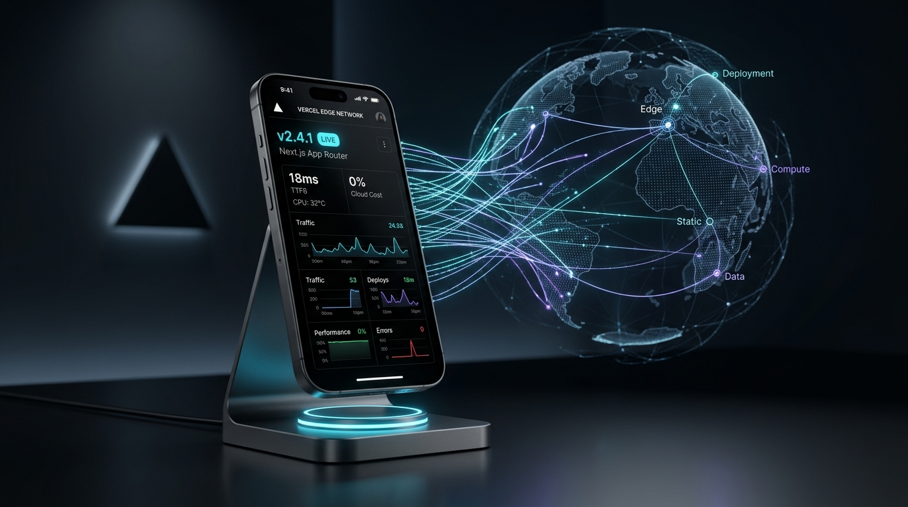
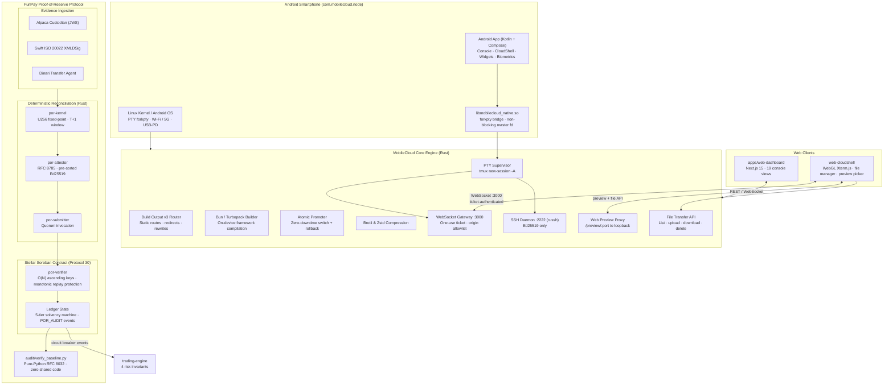
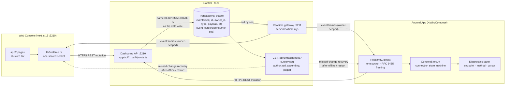
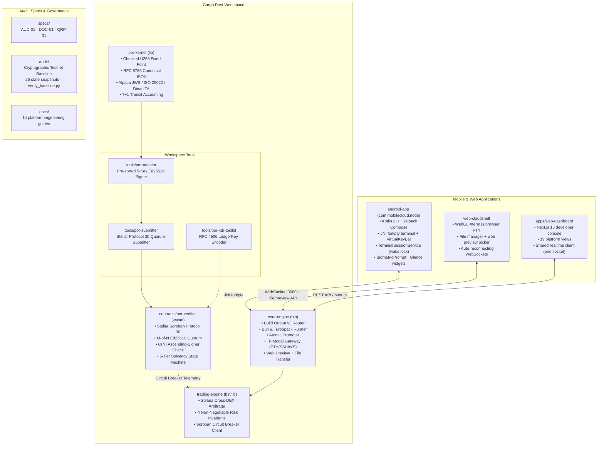

<div align="center">



### **The Autonomous Smartphone Edge Cloud & Institutional Proof-of-Reserve Protocol**

[](.github/workflows/ci.yml)
[](#automated-test-matrix)
[](Cargo.toml)
[](android-app)
[](android-app)
[](apps/web-dashboard)
[](apps/web-dashboard)
[](docs/CLOUDSHELL.md)
[](docs/REALTIME-SYNC.md)
[](docs/REALTIME-SYNC.md)
[](contracts/por-verifier)
[](core-engine)

<br/>

**MobileCloud** turns off-the-shelf Android smartphones into edge servers with an inbuilt tri-modal terminal gateway, and carries the FurlPay proof-of-reserve protocol: a deterministic reconciliation kernel, a Stellar Soroban verifier, and cryptographic attestation.

The web console and the Android app are two synchronized clients of one backend: one account, one data model, one durable event log, live both ways.

[Architecture](#system-architecture) • [Terminal](#3-tri-modal-terminal--cloudshell-gateway) • [Real-Time Sync](#unified-real-time-web--android-synchronization) • [Features](#detailed-platform-features) • [Tech Stack](#technology-stack) • [Test Matrix](#automated-test-matrix) • [Quick Start](#quick-start) • [Audit Baseline](#cryptographic-audit--integrity)

</div>

---

## Release status

**This is a local evaluation build.** Read this before the feature list, because the feature list describes what the code does, not what has been measured in production.

| Claim | Status |
| :--- | :--- |
| Android APK | A **console client**. It does not run the Rust edge engine. |
| Dashboard builds and deployments | The dashboard **records** requests; it does not execute them. Engine dispatch is disabled until isolated workers and tenant authorization exist. |
| Local build preview | **Not sandboxed.** The preview runs in the plain app UID. Do not run untrusted repositories. |
| Browser CloudShell | **Working.** Requires a running edge engine and a trusted gateway in front of it. |
| SSH daemon | **Working.** Refuses a non-loopback bind unless an Ed25519 key is authorized. |
| Trading engine | **Paper / demo.** Not validated for live execution. |
| Proof of reserve | Verified against the Stellar **testnet**. Custody and CPA attestation are `NOT_ESTABLISHED`. |
| Hardware battery bypass, energy figures, "zero-millisecond UPS" | **Not claimed.** No measurement in this repository supports them. |

---

## Technology Stack

### Languages & Runtime Engines
<p align="left">
  
  
  
  
  
  
  
</p>

### Frontend & Mobile Applications
<p align="left">
  
  
  
  
  
</p>

### Terminal & PTY Subsystem
<p align="left">
  
  
  
  
  
</p>

### Real-Time Synchronization & Data Plane
<p align="left">
  
  
  
  
  
  
</p>

### Blockchain, Smart Contracts & Financial Cryptography
<p align="left">
  
  
  
  
  
  
</p>

### Infrastructure, Networking & Security
<p align="left">
  
  
  
  
  
</p>

---

## The Unified Dual-Engine Paradigm

MobileCloud combines two decoupled, high-performance engines within one monorepo:

| ENGINE 1: MOBILECLOUD<br/>*(Autonomous On-Device Edge Cloud)* | ENGINE 2: FURLPAY PROOF-OF-RESERVE<br/>*(Verifiable Institutional RWA Telemetry)* |
| :--- | :--- |
| • Open Build Output API v3 compliant router | • RFC 8785 canonical evidence envelopes |
| • On-device Bun & Turbopack builder | • Checked 256-bit reconciliation kernel |
| • Atomic zero-downtime deployment promotion | • Alpaca JWS / ISO 20022 / Dinari TA feeds |
| • Tri-modal terminal (App, Browser, SSH) | • Acurast 3-of-5 hardware TEE quorum mesh |
| • Anycast ingress via a trusted gateway | • Stellar Soroban M-of-N Ed25519 contract |
| • Solana arbitrage engine with 4 risk invariants | • 5-tier reserve state governance machine |

---

## Detailed Platform Features

### 1. Engine 1: MobileCloud Autonomous Edge Computing
* **Open Build Output API v3 Compliance**: a native ARM64 routing daemon (`core-engine`) that parses standardized `.output` static routing rules, edge middleware redirects, rewrites, custom headers, and fallback handlers directly on Android.
* **On-Device Bun & Turbopack Builder**: compiles modern JavaScript/TypeScript frameworks (Next.js, Vite, Astro, Remix) on device, through the engine's builder module.
* **Atomic Zero-Downtime Deployment Promotion**: a symlink-based deployment switcher promoting builds with instant rollback to the previous immutable hash target.
* **Native Compression**: Brotli and Zstd streaming compression on the deployment path.
* **Image Optimization Pipeline**: an on-device `libvips` transcoding module for WebP/AVIF generation.

### 2. Tri-Modal Terminal & CloudShell Gateway
* **In-App Native PTY**: a full interactive terminal inside the Android app — Kotlin/Jetpack Compose over a JNI `forkpty` bridge, with a persistent `tmux` session so leaving the screen detaches instead of killing the shell.
* **Browser CloudShell (`web-cloudshell`)**: a browser terminal with WebGL-accelerated Xterm.js, a resilient WebSocket with exponential backoff and jitter, and reconnect that survives a reload.
* **Embedded Headless SSH Daemon**: `russh` on port `:2222`, Ed25519 public-key only, with a configurable bind that refuses a non-loopback address until a key is authorized.
* **Web Preview**: a dev server running on the phone is exposed to the browser at `/preview/<port>/` — loopback-only upstream, one port per session, token dropped from the URL after the first navigation.
* **File Transfer**: browse, upload, download, and delete inside the engine workspace; paths that escape it are refused rather than clamped.

### 3. Terminal Emulation & Touch Ergonomics
* **Full VT/xterm emulation**: alternate screen buffer (`smcup`/`rmcup`), 10 000-line scrollback, 24-bit TrueColor, 256-colour palette, SGR attributes, OSC title and clipboard, bracketed paste, and mouse reporting for `tmux` panes.
* **Event-driven rendering**: the canvas invalidates when bytes arrive, not on a 30 FPS ticker. An idle terminal costs no CPU.
* **Two-row Termux-style key bar**: sticky Ctrl/Alt/Shift, navigation keys, and shell punctuation, with an IME capture field so soft keyboards and hardware keys produce the same byte sequences.
* **Touch-to-mouse translation**: taps and drags become SGR mouse sequences, so `tmux` split panes are navigable by touch.
* **Doze-resistant sessions**: a `specialUse` foreground service with a bounded partial wake lock keeps a long build alive while the app is backgrounded.

### 4. GitHub-App-Derived Android Hardening
* **Biometric App Lock Gate**: `BiometricPrompt` on a `FragmentActivity` protects the console from unauthorized physical access.
* **Material 3 design system**: a shared dark palette and monospace type scale across the web console and the Android app.
* **Glance home-screen widgets**: Edge Node Status and Proof-of-Reserve Solvency, backed by a local state store.
* **WorkManager background daemons**: thermal telemetry and PoR attestation on an interval schedule.
* **Strict network isolation**: `network_security_config.xml` forbids cleartext traffic; exemptions are loopback only.

### 5. Next.js 15 Web Management Console (`apps/web-dashboard`)
* **Console views**: Projects, Deployments, Builds, Logs, Analytics, Monitoring, Observability, Speed, Firewall, Device, Settings, Domains, Storage, Databases, Functions, Workflows, Node, Team, Billing — and a CloudShell route.
* **Realtime gateway**: a dependency-free RFC 6455 WebSocket server that tails the same SQLite WAL the API writes.
* **QR device linking**: a two-minute single-use pairing code that the phone scans and the browser owner approves.
* **Optimistic UI with rollback**: mutations apply locally and roll back to the last confirmed snapshot if the server rejects them.

### 6. Agentic Direct Deployment & Distributed Cache Revalidation Engine
* **Direct Agent API Ingress (`POST /api/v1/deploy/agent`)**: an endpoint for AI coding agents to trigger builds, with token authentication and a custom agent id recorded on the deployment.
* **Instant Atomic Rollback API (`POST /api/v1/deploy/rollback`)**: promotes the pointer back to any prior immutable deployment with no recompilation.
* **Distributed Tag & Path Cache Revalidation (`POST /api/v1/cache/revalidate`)**: `revalidateTag()` and `revalidatePath()` across the edge cache.
* **Deployment Audit & History API (`GET /api/v1/deployments/:project`)**: the full deployment history, including the exact trigger source (`agent:…`, `git:push`).

### 7. Engine 2: FurlPay Proof-of-Reserve Protocol
* **Checked 256-Bit Mathematical Kernel (`por-kernel`)**: every accounting operation runs over checked fixed-point `U256` arithmetic with 18 decimal places of precision, so overflow is a type error rather than a silent wrap.
* **RFC 8785 Canonical JSON & Domain Separation**: evidence envelopes are normalized per RFC 8785 with domain-separated SHA-256 preimages.
* **Multi-Format Institutional Ingestion Parsers**: Alpaca JWS, ISO 20022 `camt.053` XMLDSig, and Dinari transfer-agent reconciliation.
* **Strict T+1 Settlement & Zero-Rehypothecation**: transit balances are validated against the settlement window; assets with `shares_on_loan > 0` are rejected.

### 8. Hardened Stellar Soroban Smart Contract (`por-verifier`)
* **Stellar Protocol 30 Compatibility**: the contract runs on the Soroban WASM runtime.
* **Ascending-Key O(N) Quorum Validation**: M-of-N verification requires signers in strictly ascending lexicographic order of their Ed25519 public keys, making duplicate-signer and Sybil attacks structurally impossible.
* **Independent On-Chain Solvency Calculation**: the contract recomputes the reserve ratio on-chain before updating state, so an off-chain oracle cannot manipulate it.
* **5-Tier Governance State Machine**: `OPTIMAL` → `ACCEPTABLE` → `WARNING` → `EMERGENCY` → `INSOLVENT`, each with its own trading, minting, and freeze consequences.

### 9. Edge Trading Engine (`trading-engine`)
* **Paper/demo execution**: cross-DEX routing modelled on Solana venues. Not validated for live execution and not connected to a funded account.
* **4 Non-Negotiable Invariants**:
  1. *Atomic-Only Reverts*: any non-profitable or interrupted route reverts in full without balance loss.
  2. *2.5% Maximum Capital Cap*: a strict exposure threshold per trade.
  3. *20% T+1 Buffer*: a minimum liquid capital buffer reserved at all times.
  4. *15 bps Max Slippage*: a strict execution boundary.
* **Soroban Circuit Breaker Client**: halts trading whenever the Stellar PoR contract leaves the optimal state.

### 10. Unified Real-Time Web ⇄ Android Synchronization
* **One Account, One Backend, One Source of Truth**: the Next.js console and the Android app are two authenticated clients of the same API, database, and event log — never two divergent copies.
* **Authenticated WebSocket Gateway (`wss://<host>/api/realtime`)**: a dependency-free RFC 6455 implementation on port `3211` reading the same SQLite WAL file. Authentication happens in the HTTP upgrade (session cookie or bearer token hashed with SHA-256); an anonymous upgrade is rejected and reported as *sign-in required*, never as a network failure.
* **Transactional Outbox**: every mutation writes its event row inside the same `BEGIN IMMEDIATE` transaction as the data change, so a dropped socket frame can never lose a change.
* **Cursor Synchronization (`GET /api/sync/changes?cursor=<seq>`)**: authorized, per-account, ascending replay of everything a client missed.
* **Shared Event Envelope**: `event_id · event_type · schema_version · account_id · resource_id · sequence · occurred_at · payload`.
* **One Socket Per Client**: both clients run a single shared realtime service, with reconnect backoff and jitter, heartbeats with dead-peer detection, `event_id` dedupe, sequence-gap recovery, and a bounded polling fallback.
* **QR Device Linking, Not Password Typing**: the console's **Link device** page shows a two-minute, single-use code; the phone scans it, the browser owner approves it, and the claim issues both a durable device credential and the session cookie.
* **No ADB Reverse Dependency**: the app discovers its control plane by validating `/api/health` across the last-known endpoint, loopback, the emulator alias, and the device's own `/24`, under fixed per-candidate timeouts.
* **Connection Diagnostics**: an explicit state machine drives a panel showing the active endpoint, connection method, last health check, last sync, cursor, pending changes, and last error.

> Full protocol, schema, and guarantees: [`docs/REALTIME-SYNC.md`](docs/REALTIME-SYNC.md).

---

## System Architecture



---

## Unified Real-Time Synchronization

The socket is a latency optimisation; the **outbox row is the guarantee**.



| Property | Mechanism |
| :--- | :--- |
| No lost change | Event row commits in the same transaction as the data mutation |
| Ordered delivery | Global monotonic `sequence`; clients detect and repair gaps |
| Exactly-once effect | `event_id` dedupe on the client, cursor monotonicity on the server |
| Offline recovery | `GET /api/sync/changes?cursor=…`, paged, oldest-first |
| Tenant isolation | Every event is scoped by `owner_id` before delivery and before replay |
| Graceful degradation | Bounded polling fallback when WebSockets cannot connect |
| No socket per screen | One shared realtime client in each application |

---

## Monorepo Crate & Subsystem Architecture



---

## Automated Test Matrix

| Subsystem | Test Suite | Invariant Enforced |
| :--- | :--- | :--- |
| **`por-kernel`** | 58 tests | `U256` checked arithmetic, zero overflows across 10,000 edge cases, strict T+1 DTCC clearing window, zero-rehypothecation (`shares_on_loan == 0`). |
| **`por-verifier`** | 25 tests | Monotonic sequence replay defense, TTL freshness expiration, O(N) ascending-key validation, duplicate signer rejection, 5-tier solvency state transitions. |
| **`core-engine`** | 35 tests | Build Output v3 routing, agentic deployment ingress, cache tag revalidation, atomic promotion and rollback, PTY session allocation, terminal ticket single-use, origin allowlisting, preview session port binding, file-transfer path confinement. |
| **`trading-engine`** | 17 tests | Arbitrage profitability checks, integer-exact fee calculations, 4 risk invariants (atomic reverts, 2.5% max exposure, 15 bps slippage, 20% T+1 buffer). |
| **`por-xdr-toolkit`** | 4 tests | Protocol 30 XDR encoding/decoding, RFC 4506 `Option<ScVec>` presence-flag alignment. |
| **`apps/web-dashboard`** | 28 tests | Real-time synchronization: a mutation commits its outbox row in the same transaction; a live WebSocket client receives it; a reconnect replays missed changes exactly once and in order; cross-account isolation; anonymous socket upgrade and unauthenticated `GET /api/sync/changes` are rejected. QR device pairing: scan → browser approval → claim mints a credential **and** signs the phone in; a tampered secret, a stranger's pairing, an unapproved early claim, an expired session and a replayed claim are each refused; a new QR code supersedes the previous one. Runs the real `server/realtime.mjs` gateway as a child process, not a mock. |

**167 tests** in total.

```bash
# Rust workspace (default members)
cargo test

# The Soroban contract crate (host build) and the standalone audit tool
cargo test -p por-verifier
cd tools/por-xdr-toolkit && cargo test && cd ../..

# Dashboard synchronization + QR pairing suite (Node's built-in test runner)
cd apps/web-dashboard && npm test
```

---

## Quick Start

### 1. Prerequisites

* **Rust Toolchain**: `rustc 1.80+`; add the `wasm32-unknown-unknown` target for the contract crate.
* **Android SDK / NDK**: build-tools 35, NDK 27.1.12297006, CMake 3.22.1, JDK 17 or 21.
* **Node.js**: 22.13 or later (the console uses `node:sqlite` and `--experimental-strip-types`).

### 2. Verify the workspace

```bash
git clone https://github.com/Ashutosh0x/mobilecloud-platform.git
cd mobilecloud-platform

cargo test                      # 110 tests in the default members
cargo test -p por-verifier      # 25 contract tests
cd apps/web-dashboard && npm test && cd ../..   # 28 dashboard tests
```

### 3. Run the web console

Before the first sign-in, set `MOBILECLOUD_BOOTSTRAP_PASSWORD` to a unique password of at least 12 characters, and `MOBILECLOUD_BOOTSTRAP_EMAIL` if you want an address other than `owner@mobilecloud.local`. Remove the password from the environment once the account is provisioned — the console does not log it and there is no public signup.

```bash
cd apps/web-dashboard
npm ci
npm run dev     # console :3210, realtime gateway :3211
```

Open `http://localhost:3210`. The database defaults to `apps/web-dashboard/data/mobilecloud.db`; set `MOBILECLOUD_DB` to relocate it. The gateway is a separate process on purpose: a Next.js route handler cannot answer an HTTP `upgrade`, so the WebSocket listener runs beside the API and tails the same WAL file.

### 4. Run the browser CloudShell

The dev server proxies the engine's routes and attaches the operator credential — the only place that credential appears:

```bash
export MOBILECLOUD_ENGINE=http://127.0.0.1:3000
export MOBILECLOUD_OPERATOR_TOKEN=…        # the engine's operator token
cd web-cloudshell && npm ci && npm run dev  # http://localhost:5173
```

In production the same role is played by the reverse proxy in front of the engine; the configuration is in [`docs/CLOUDSHELL.md`](docs/CLOUDSHELL.md).

### 5. Build and connect Android

Use an ARM64 device running Android 11 (API 30) or newer. Point `android-app/local.properties` at your SDK.

```bash
cd android-app
./gradlew :app:assembleDebug :app:lintDebug
./gradlew :app:installDebug
```

Enter and confirm the phone-reachable HTTPS origin, then sign in with the operator account. There is no cleartext or automatic LAN discovery fallback. To pair by QR instead, open the device page on the HTTPS dashboard, generate a code, and scan it in the app — compare the origin and verification code before approving in the browser.

From the repository root, [`scripts/build-and-sign-apk.sh`](scripts/build-and-sign-apk.sh) aligns, signs, and verifies the APK against a trusted certificate fingerprint. It requires an existing release keystore and protected signing inputs. **Do not distribute an APK until historical signing-credential exposure has been assessed and the signed build has been verified on physical hardware.**

### 6. What still needs a physical device

Backup and migration recovery, HTTPS/WSS routing, pairing, reconnect, and revocation on real hardware, and a signed release verified on an ARM64 device. Keep public builds disabled until workers and tenant authorization are isolated. Reserve and trading claims require independent validation.

---

## Cryptographic Audit & Integrity

The proof-of-reserve path is sealed end to end:

```bash
# repo-wide integrity manifest (56 entries)
sha256sum -c INTEGRITY_MANIFEST.sha256

# the frozen 2026-11-21 testnet baseline
cd audit/TESTNET_BASELINE_2026-11-21 && sha256sum -c MANIFEST.sha256

# independent pure-Python RFC 8032 verification of the 3-of-5 quorum
python -I audit/TESTNET_BASELINE_2026-11-21/crypto/verify_baseline.py
```

The manifest seals the 26 regression snapshots, the contract sources, the crate manifests, the release WASM, and the public documentation set. Commit anchors and toolchain versions are in [`versions.txt`](versions.txt).

---

## Documentation Index

| Document | Contents |
| :--- | :--- |
| [CLOUDSHELL.md](docs/CLOUDSHELL.md) | The tri-modal terminal: credential model, web preview, file transfer, session durability, reverse-proxy configuration |
| [ARCHITECTURE.md](docs/ARCHITECTURE.md) | Dual-cadence assurance model, component dataflow, platform real-time plane |
| [REALTIME-SYNC.md](docs/REALTIME-SYNC.md) | Unified Web ⇄ Android real-time sync: event envelope, transactional outbox, WebSocket gateway protocol, cursor recovery, cross-device auth |
| [SECURITY-MODEL.md](docs/SECURITY-MODEL.md) | Quorum design, digest scheme, threat matrix |
| [VERIFIED-BASELINE.md](docs/VERIFIED-BASELINE.md) | Testnet evidence: transaction hashes, ledgers, live attack rejections |
| [SOLVENCY-MODEL.md](docs/SOLVENCY-MODEL.md) | Basis-point scale, thresholds, ratio math |
| [PROTOCOL-30-XDR.md](docs/PROTOCOL-30-XDR.md) | XDR wire-format invariants and the `Option<ScVec>` presence flag |
| [GOVERNANCE.md](docs/GOVERNANCE.md) | Gate 7 per-asset policies, validation rules, non-retroactivity |
| [STELLAR-SOROBAN.md](docs/STELLAR-SOROBAN.md) | Contract mechanics, TTL/archival behavior, events |
| [ACURAST-TEE.md](docs/ACURAST-TEE.md) | Attestor signing architecture and TEE roadmap |
| [INTEGRATION-GUIDE.md](docs/INTEGRATION-GUIDE.md) | How to read and independently verify the proof-of-reserve |
| [ROADMAP.md](docs/ROADMAP.md) | Phase 1–6 plan with honest status tags |
| [AUDIT-EVIDENCE.md](docs/AUDIT-EVIDENCE.md) | Integrity manifests, verification scripts, commit anchors |

---

<div align="center">

**MobileCloud & FurlPay** — one account, one data model, one durable event log.

[](.github/workflows/ci.yml)
[](#automated-test-matrix)

</div>
