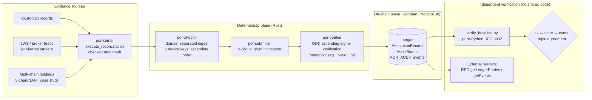
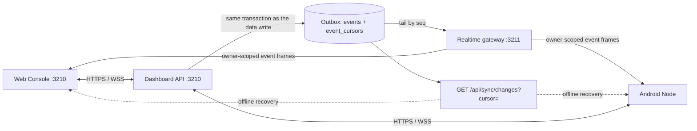

# Architecture — Dual-Cadence Proof-of-Reserve Assurance

Status tags: [DEPLOYED] where live evidence exists · [VERIFIED_SOURCE] where
source + tests verify the claim.

## The two planes (deliberately independent)

The Rust signing pipeline and the Python verifier share **zero code**. A bug
would have to exist in both, independently, plus survive on-chain checks —
that is the acceptance posture.

## Components [VERIFIED_SOURCE]

| Component | Role | Key facts |
| :--- | :--- | :--- |
| `por-kernel` (58 tests) | Deterministic reconciliation: circulating supply across chains vs settled + in-transit reserves; envelope digest | Case study: 1,000,000 circulating = 850,000 DTC-settled + 150,000 T+1 transit; 18-decimal `SHARE = 10^18`; JWS parser (`parsers/alpaca_jws.rs`) |
| `por-attestor` | Bridges kernel → contract: derives the exact digest and signs with 5 deterministic device keys, emitting CLI-ready JSON for `stellar contract invoke` | `ed25519-dalek`; signatures pre-sorted ascending (contract requires it) |
| `por-submitter` | Posts the quorum invocation; used for the T1–T12 live run | RPC Protocol 30 |
| `contracts/por-verifier` (23 tests) | On-chain verifier: quorum, sequence monotonicity, `valid_until` freshness, checked ratio math, per-asset policies, status + events | Deployed at `CDWN…EDPI`; WASM hash `8ebceb…3648` |
| `trading-engine` (10 tests) | External circuit-breaker wiring point (`soroban_circuit_breaker`) — status consumption, not autonomous control | See SOLVENCY/GOVERNANCE advisory model |
| `core-engine` (16 tests) | Platform services (builder/proxy/terminal gateway) | Not part of the PoR trust path |
| `tools/por-xdr-toolkit` (4 tests) | Canonical `LedgerKey` encoder/decoder; pins the RFC 4506 `Option<ScVec>` presence-flag layout | Promoted from the frozen `xdrkey` baseline tool |

## Digest & quorum [DEPLOYED]

- Digest preimage (62 bytes, fixed-width big-endian):
  `"FURLPAY_POR_V1" ‖ seq(u64) ‖ epoch(u64) ‖ reserves(u128) ‖ supply(u128)`
- Quorum: **3-of-5 Ed25519**, signatures in **strictly ascending public-key
  order** (duplicates structurally impossible in O(N)).
- Off-chain quarterly reports use a length-prefixed encoding (extensible);
  both schemes are documented in `specs/FP-ENG-2026-QRP-01.md` §5.

## Cadence

1. **Per-attestation (event cadence):** kernel → attestor → submitter →
   on-chain verification → `POR_AUDIT` event. Six consecutive live
   attestations (seq 2→7) with zero sequence gaps [DEPLOYED].
2. **Quarterly (institutional cadence):** report built per
   `specs/FP-ENG-2026-QRP-01.md` §7 — reserve composition, ratio table,
   digests, on-chain evidence, incidents, toolchain fingerprint
   [`NOT_ESTABLISHED` until a CPA/custodian engages].

## What the on-chain contract does NOT do

It publishes status; it does not control third parties. Halting trading or
minting requires external wiring (e.g. `trading-engine::soroban_circuit_breaker`
or a token transfer hook) — see GOVERNANCE.md §Advisory model.

## The MobileCloud plane: Web console ⇄ Android node [VERIFIED_SOURCE]

The PoR plane above is deliberately independent of the platform plane. The
platform plane has its own architecture, documented in full in
[REALTIME-SYNC.md](REALTIME-SYNC.md):

Key decisions:

| Decision | Reason |
| :--- | :--- |
| Separate gateway process on `:3211` | A Next.js route handler cannot answer an HTTP `upgrade`; the gateway tails the same SQLite WAL file |
| Transactional outbox instead of socket-only notification | A client that is asleep must still recover the change; delivery is never the only record |
| Global monotonic `sequence` + `event_id` | Ordering, gap detection, cursor bookkeeping and idempotent processing from one counter |
| Authorized catch-up endpoint rather than client-side diffing | The server decides what a tenant may see; clients cannot read another account's log |
| Endpoint discovery with bounded timeouts, single-flight, validated caching | Deterministic on Wi-Fi, mobile data, VPN or USB without depending on `adb reverse` |
| Explicit connection state machine | `401` is "sign in required", not "unreachable"; `403` is not a reason to re-discover |

Honest status: the outbox, gateway, authorization and offline-recovery paths are
covered by automated tests (`apps/web-dashboard`, 92 tests) that spawn the real
gateway. Conflict handling is last-write-wins; multi-control-plane scaling and a
packaged public tunnel are **not** implemented. See REALTIME-SYNC.md §13.

## Repository component map (recounted 2026-11-27)

Verified test counts below were produced by the commands in
[`IMPLEMENTATION_AUDIT.md`](IMPLEMENTATION_AUDIT.md) §2. This map is the
authoritative component inventory for the whole repository; the PoR trust path
(the top of this document) is one plane within it.

| Component | Kind | Role | Tests |
| :--- | :--- | :--- | ---: |
| `core-engine` | binary (axum) | Build pipeline, Build-Output-v3 router (cached route table, sidecar serving), tri-modal terminal gateway, web preview, file transfer. | 39 |
| `por-kernel` | library | Checked `U256` reconciliation, RFC 8785 canonical JSON, financial parsers, T+1 transit. | 45 + 13 |
| `trading-engine` | library + bin | Paper/demo arbitrage, four risk invariants, Soroban circuit-breaker client. | 17 |
| `contracts/por-verifier` | Soroban contract | On-chain quorum verifier (wasm; excluded from default members). | 25 |
| `tools/por-attestor`, `tools/por-submitter` | bins | Digest derivation + signing; quorum submission. | 0 |
| `tools/por-xdr-toolkit` | lib/bin | RFC 4506 `LedgerKey` encoder. | 4 |
| `edge/mobilecloud-shield` | library | Blocklist, sliding-window rate limiter, regex WAF. | 11 |
| `edge/mobilecloud-tunnel` | bins | `mc-tunnel-client` / `mc-tunnel-relay`; Ed25519 handshake, yamux, WSS. | 7 |
| `fleet-mesh` | library | Node registry, Ed25519 device identity, replay-protected heartbeats, revocation, telemetry provenance, health sweeps, placement, authenticated API. | 43 |
| `apps/web-dashboard` | Next.js app | Console, realtime gateway, unified authentication (passkeys, QR login, device and PKCE grants), QR pairing, platform services, metering, PoR read-only view. | 92 |
| `android-app` | Android app | Compose console, JNI `forkpty` terminal, foreground session service. | build + lint |
| `mobilecloud-cli` | binary | `login` (device grant and PKCE), `logout`, `whoami`, `devices`, `sessions`, revocation; rotating tokens in a 0600 credentials file. | 8 |
| `web-cloudshell` | Vite app | Browser WebGL XTerm.js PTY, file manager, preview picker. | build only |

Related engineering documents: [`IMPLEMENTATION_AUDIT.md`](IMPLEMENTATION_AUDIT.md),
[`IMPLEMENTATION_ROADMAP.md`](IMPLEMENTATION_ROADMAP.md),
[`SECURITY_THREAT_MODEL.md`](SECURITY_THREAT_MODEL.md),
[`PRODUCTION_READINESS.md`](PRODUCTION_READINESS.md).

