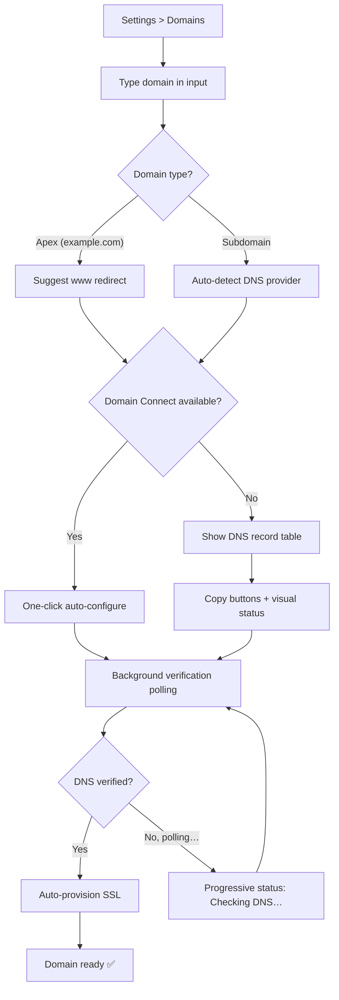
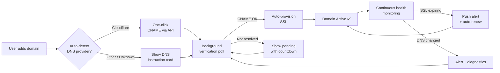
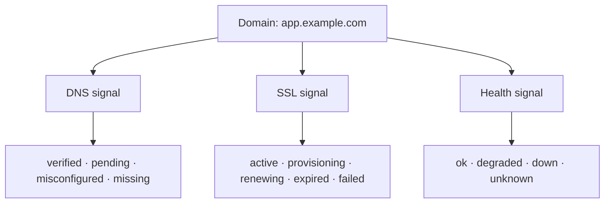
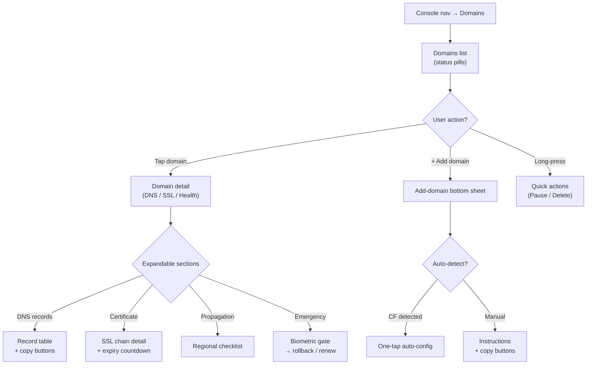
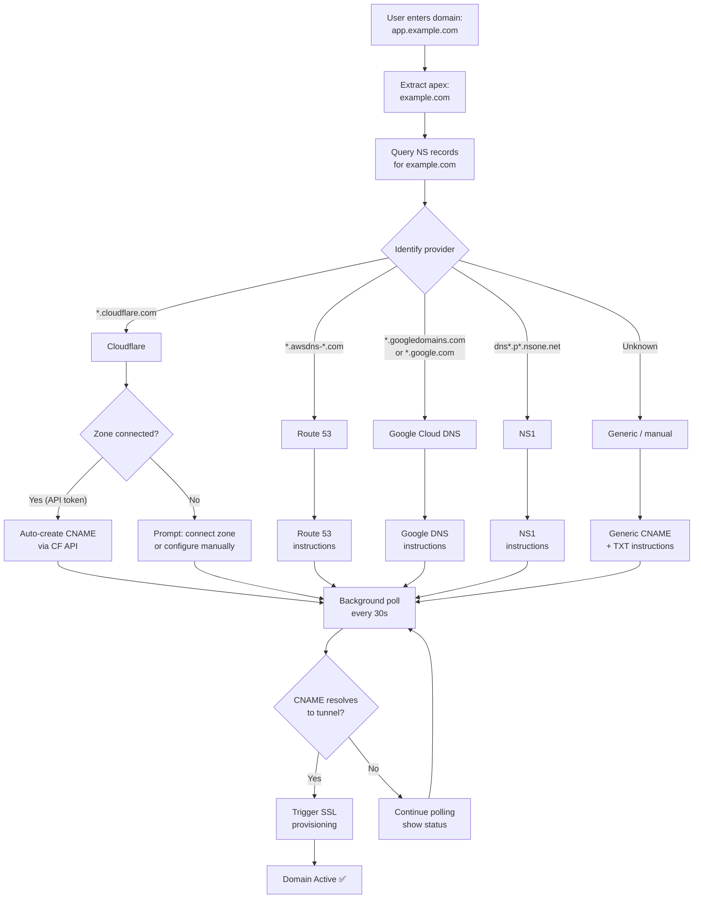
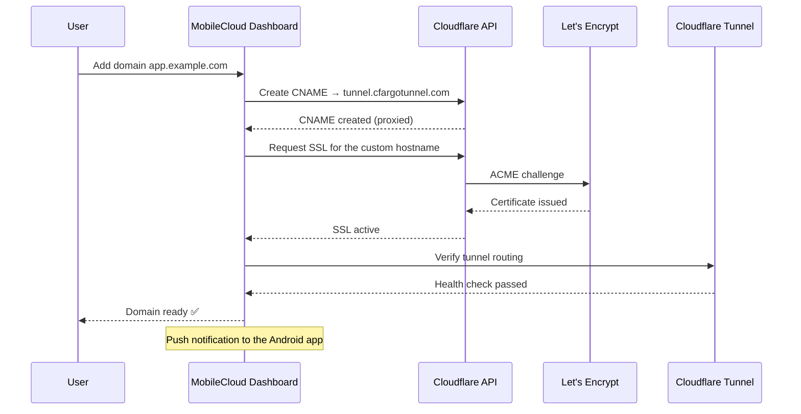
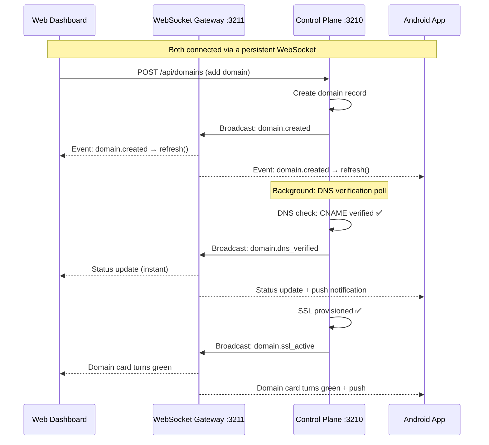
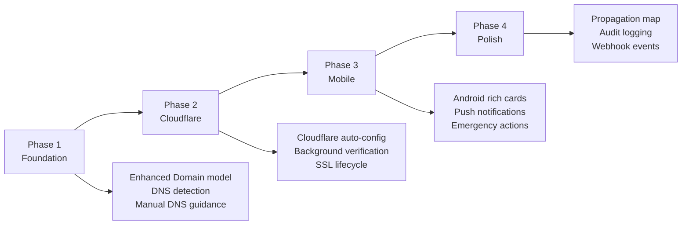

# MobileCloud Domain Configuration — UI/UX Design Specification

## Web Dashboard + Android App · Domain Lifecycle, DNS Discovery, SSL & Real-Time Sync

**Revision 2.0 — November 28, 2026**

> [!NOTE]
> **This is a design specification, not a status report.** Sections 5–13 describe a
> **proposed** experience. The current state (Section 3) is the ground truth, taken
> directly from the code in this repository. Every proposed surface is tagged
> `proposed`; every existing surface is tagged with the repository's status
> taxonomy (`implemented` · `partial` · `absent`).

---

## Table of Contents

1. [Executive Summary](#1-executive-summary)
2. [Reading This Document](#2-reading-this-document)
3. [Current State Analysis (Ground Truth)](#3-current-state-analysis-ground-truth)
4. [Design Principles & System](#4-design-principles--system)
5. [Competitor Domain UX Audit](#5-competitor-domain-ux-audit)
6. [Proposed Domain UX Architecture](#6-proposed-domain-ux-architecture)
7. [Web Dashboard — Domain Configuration Flow](#7-web-dashboard--domain-configuration-flow)
8. [Android App — Domain Management Flow](#8-android-app--domain-management-flow)
9. [Auto-Detection & DNS Discovery Engine](#9-auto-detection--dns-discovery-engine)
10. [SSL/TLS Certificate Lifecycle UX](#10-ssltls-certificate-lifecycle-ux)
11. [Real-Time Sync Architecture](#11-real-time-sync-architecture)
12. [API Design for Domain Management](#12-api-design-for-domain-management)
13. [States: Empty, Loading, Error & Recovery](#13-states-empty-loading-error--recovery)
14. [MobileCloud vs Competitors — Feature Matrix](#14-mobilecloud-vs-competitors--feature-matrix)
15. [Component & File Mapping](#15-component--file-mapping)
16. [Implementation Roadmap](#16-implementation-roadmap)
17. [Wireframe Specifications](#17-wireframe-specifications)

- [Appendix A — Passkey Step-Up for Domain Operations](#appendix-a--passkey-step-up-for-domain-operations)
- [Appendix B — Webhook Events for the Domain Lifecycle](#appendix-b--webhook-events-for-the-domain-lifecycle)
- [Appendix C — Feature Status Ledger](#appendix-c--feature-status-ledger)
- [Appendix D — What Changed in Revision 2.0](#appendix-d--what-changed-in-revision-20)

---

## 1. Executive Summary

This specification defines a complete **domain configuration** experience for the
MobileCloud platform across both clients:

- the **web dashboard** (Next.js 15, `apps/web-dashboard`), and
- the **Android app** (Kotlin / Jetpack Compose, `android-app`),

covering hostname intake, **DNS provider auto-detection**, **DNS verification**,
**SSL certificate provisioning**, **real-time cross-platform sync**, and the
complete set of empty / loading / error states around them.

> [!IMPORTANT]
> **Current state.** The Domains view exists in both clients as a **record-only**
> interface. A hostname is stored locally, but there is **no DNS provider
> integration, no SSL provisioning, and no domain verification** wired into either
> client. The existing Cloudflare automation
> ([`scripts/cloudflare-dns.mjs`](../scripts/cloudflare-dns.mjs)) is a CLI-only
> deployment script and is not surfaced in the dashboard.

### 1.1 What Makes MobileCloud's Domain Management Distinct

| Differentiator | Description |
| :--- | :--- |
| **Mobile-first domain management** | Full domain lifecycle on Android, including biometric-gated emergency actions |
| **Edge-native via Cloudflare Tunnel** | Zero published ports — domains route through the same tunnel that powers the platform |
| **Real-time WebSocket sync** | Domain status changes propagate instantly between web ⇄ Android |
| **Passkey-bound destructive operations** | Destructive domain changes require a WebAuthn UV step-up |
| **Proof-of-Reserve domain trust** | Domains tied to the cryptographic attestation chain used by FurlPay |

### 1.2 Source Files Analysed

| File | Client | Role |
| :--- | :--- | :--- |
| [`app/(console)/domains/page.tsx`](../apps/web-dashboard/app/(console)/domains/page.tsx) | Web | Domains route entry point |
| [`components/FeatureViews.tsx`](../apps/web-dashboard/components/FeatureViews.tsx#L127-L171) | Web | `DomainsView` component |
| [`lib/types.ts`](../apps/web-dashboard/lib/types.ts#L29-L35) | Web | `Domain` type definition |
| [`lib/store.tsx`](../apps/web-dashboard/lib/store.tsx) | Web | State management (`domains: Domain[]`) |
| [`lib/realtime.ts`](../apps/web-dashboard/lib/realtime.ts) | Web | Shared realtime client |
| [`lib/server/stepup.ts`](../apps/web-dashboard/lib/server/stepup.ts) | Web | Passkey step-up token issuance |
| [`lib/server/webhook.ts`](../apps/web-dashboard/lib/server/webhook.ts) | Web | Signed webhook delivery |
| [`ui/console/pages/InfraPages.kt`](../android-app/app/src/main/kotlin/com/mobilecloud/ui/console/pages/InfraPages.kt#L48-L105) | Android | `DomainsPage` composable |
| [`console/Models.kt`](../android-app/app/src/main/kotlin/com/mobilecloud/console/Models.kt) | Android | Kotlin `Domain` data class |
| [`scripts/cloudflare-dns.mjs`](../scripts/cloudflare-dns.mjs) | Scripts | Idempotent Cloudflare CNAME management |

---

## 2. Reading This Document

### 2.1 Status Taxonomy

This document uses the repository's status vocabulary. A claim is only ever as
strong as its tag.

| Tag | Meaning |
| :--- | :--- |
| `implemented` | Present in the code and covered by the platform's tests |
| `partial` | Present but with a stated caveat or incomplete surface |
| `absent` | Not present in the code |
| `proposed` | A design in this specification; no code exists yet |

### 2.2 Status Badge Semantics (UI vocabulary)

The experience proposed below uses a fixed, colour-blind-safe status vocabulary.
The same semantics apply in the web console and the Android app.

| Badge | Colour token | Meaning | Never means |
| :--- | :--- | :--- | :--- |
| ✅ Verified / Active | `--status-ok` (green) | Working and verified | "was ever verified" |
| ⏳ In progress | `--status-pending` (amber) | A background operation is running | Failure |
| ⚠️ Attention | `--status-warn` (orange) | A human action is likely required | Blocked |
| ❌ Failed | `--status-error` (red) | The operation did not succeed | Permanently broken |
| ○ Not started | `--status-idle` (neutral) | No attempt has been made yet | Failure |

---

## 3. Current State Analysis (Ground Truth)

### 3.1 Existing Domain Type (TypeScript) — `implemented`

```typescript
// apps/web-dashboard/lib/types.ts — lines 29-35
export type Domain = {
  id: string;
  host: string;        // e.g., "app.example.com"
  project: string;     // linked project name
  status: "recorded";  // ← only one status value exists today
  detail: string;      // description text
};
```

### 3.2 Existing Domain Type (Kotlin — Android) — `implemented`

```kotlin
// android-app/.../console/Models.kt — line 15
data class Domain(
    val id: String,
    val host: String,
    val project: String,
    val status: String,
    val detail: String
)
```

### 3.3 Current Web Dashboard `DomainsView`

The existing component in
[`FeatureViews.tsx`](../apps/web-dashboard/components/FeatureViews.tsx#L127-L171)
provides:

| Feature | Status | Detail |
| :--- | :--- | :--- |
| Hostname input field | `implemented` | `placeholder="app.example.com"` |
| Project selector dropdown | `implemented` | Populated from `state.projects` |
| Record button | `implemented` | POST to the `domains` API |
| Domain list display | `implemented` | Shows host, project, status, detail |
| Remove domain (confirm dialog) | `implemented` | Optimistic delete with rollback |
| Search / filter | `implemented` | Via the `useFiltered` hook |
| DNS verification | `absent` | "No DNS provider is configured" |
| SSL certificate status | `absent` | No TLS lifecycle |
| Auto-detection | `absent` | No DNS record scanning |
| Domain health check | `absent` | No live connectivity test |
| DNS record guidance | `absent` | No instruction cards |

### 3.4 Current Android `DomainsPage`

The [`DomainsPage`](../android-app/app/src/main/kotlin/com/mobilecloud/ui/console/pages/InfraPages.kt#L48-L105)
composable mirrors the web exactly:

- `CField("Hostname", …)` input
- `CSelect` for project
- `CButton("Record", …)` to save
- A list of domains with a Remove action
- A `ConfirmDialog` for deletion

### 3.5 Existing Cloudflare DNS Script — `partial`

The [`cloudflare-dns.mjs`](../scripts/cloudflare-dns.mjs) script already handles:

```text
✅ Idempotent CNAME creation/update via the Cloudflare API
✅ Zone validation (zone name matches FURLPAY_DOMAIN)
✅ Conflict detection (refuses to overwrite non-CNAME records)
✅ Dry-run mode (default) vs --apply mode
✅ Multi-host support via the FURLPAY_HOSTS env var
✅ Proxied CNAME targeting <tunnel-id>.cfargotunnel.com
```

> [!NOTE]
> The DNS automation logic already exists but is **CLI-only**. The proposed
> experience surfaces the same Cloudflare API integration inside the dashboard and
> the Android app — turning a DevOps script into a user-facing feature guarded by
> passkey step-up.

---

## 4. Design Principles & System

### 4.1 Five Principles

1. **Intent over syntax.** Never ask "which record type?" — ask "what are you
   trying to do?" and generate the records.
2. **Status is the interface.** A user should be able to read the health of every
   domain from colour and one short label, without opening a detail view.
3. **The next action is always visible.** Every non-green state names exactly one
   next step and offers it as a button.
4. **Progressive disclosure.** Depth (records, certificate chain, propagation) is
   one tap away, never on the critical path.
5. **Honest states.** A spinner is never used to imply success. A completed action
   is labelled as completed only once it is verified.

### 4.2 Status Semantics in Context

Each domain carries **three independent signals** — DNS, SSL, and Health. They are
displayed separately because they fail independently and require different fixes.

| Signal | States | Primary colour signal |
| :--- | :--- | :--- |
| **DNS** | `pending` · `verified` · `misconfigured` · `missing` | Green / amber / orange / red |
| **SSL** | `none` · `provisioning` · `active` · `renewing` · `expired` · `failed` | Neutral / amber / green / amber / red / red |
| **Health** | `ok` · `degraded` · `down` · `unknown` | Green / amber / red / neutral |

### 4.3 Typography, Spacing & Motion

| Token | Value | Use |
| :--- | :--- | :--- |
| Display | 20 px / 600 | Page heading ("Domains") |
| Title | 15 px / 600 | Domain card hostname |
| Body | 14 px / 400 | Descriptions, labels |
| Mono | 13 px / 400 | Hostnames, record values, IPs |
| Radius | 12 px (cards), 8 px (inputs) | Consistent geometry |
| Space scale | 4 · 8 · 12 · 16 · 24 · 32 | Layout rhythm |
| Motion | 150 ms ease-out | Status transitions, expand/collapse |

Respect `prefers-reduced-motion`: replace the status-transition animation with an
instant state swap and keep the colour change.

### 4.4 Accessibility & Inclusive Design

| Requirement | Implementation |
| :--- | :--- |
| Colour is never the only signal | Every badge pairs a colour with an icon **and** a text label |
| Contrast | Status text meets WCAG 2.2 AA (≥ 4.5:1) on the dark surface |
| Touch targets | ≥ 44 × 44 px on Android, ≥ 40 × 40 px on web pointers |
| Keyboard | Every action is reachable by Tab; the record table is navigable by arrow keys |
| Screen readers | Status changes are announced via a polite live region (`aria-live="polite"` / Compose semantics) |
| Copy buttons | Announce "Copied" via a live region, not colour alone |
| Reduced motion | All transitions honour `prefers-reduced-motion` |

---

## 5. Competitor Domain UX Audit

### 5.1 Vercel Domain Configuration Flow (2026)



**Key Vercel UX patterns:** context-aware input; Domain Connect one-click setup;
colour-coded status badges; background polling (~20 s, no manual "Verify" button);
progressive status copy; modular UI blocks via `@vercel/platforms`.

### 5.2 Cloudflare Custom Hostnames Flow (2026)

**Key patterns:** separated `hostname.status` vs `ssl.status`; required fallback
origin; DCV Delegation to bypass per-domain TXT verification; manual refresh for
stuck validations; CA selection (Let's Encrypt / DigiCert); API-first parity.

### 5.3 Netlify Domain Management Flow (2026)

**Key patterns:** decision wizard ("Have you registered your domain?"); Managed vs
External DNS tradeoff UI; in-app ownership verification; automatic apex + www
handling; enterprise "domain capture" governance.

### 5.4 Comparative Summary

| Feature | Vercel | Cloudflare | Netlify | MobileCloud (Current) | MobileCloud (Proposed) |
| :--- | :---: | :---: | :---: | :---: | :---: |
| Domain input + validation | ✅ | ✅ | ✅ | ✅ | ✅ |
| DNS record guidance | ✅ | ✅ | ✅ | ❌ | ✅ |
| Auto-detect DNS provider | ✅ | ✅ | ✅ | ❌ | ✅ |
| One-click DNS config | ✅ | ✅ | ❌ | ❌ | ✅ |
| Background verification | ✅ | ✅ | ❌ | ❌ | ✅ |
| Auto SSL provisioning | ✅ | ✅ | ✅ | ❌ | ✅ |
| SSL status separate from DNS | ❌ | ✅ | ❌ | ❌ | ✅ |
| Multi-status state machine | ✅ | ✅ | Partial | ❌ | ✅ |
| Mobile app management | ❌ | ✅* | ❌ | ✅ (record only) | ✅ (full) |
| Real-time sync web ⇄ mobile | ❌ | ❌ | ❌ | ✅ | ✅ |
| Passkey-gated operations | ❌ | ❌ | ❌ | ❌ | ✅ |
| Edge tunnel integration | ❌ | N/A | ❌ | ✅ | ✅ |
| Domain Connect protocol | ✅ | ❌ | ❌ | ❌ | ✅ |
| Push notifications for expiry | ❌ | ✅* | ❌ | ❌ | ✅ |

*\* Cloudflare has a mobile app but limited domain management.*

---

## 6. Proposed Domain UX Architecture

### 6.1 Enhanced Domain Type — `proposed`

```typescript
// PROPOSED: Enhanced Domain type
export type DomainStatus =
  | "pending_dns"       // DNS records not yet detected
  | "dns_verified"      // CNAME resolves correctly
  | "ssl_provisioning"  // Certificate being issued
  | "active"            // Fully live with valid SSL
  | "ssl_expiring"      // Certificate expires within 30 days
  | "ssl_expired"       // Certificate has expired
  | "dns_misconfigured" // CNAME points to the wrong target
  | "suspended"         // Admin-suspended
  | "deleting";         // Scheduled for removal

export type Domain = {
  id: string;
  host: string;
  project: string;
  status: DomainStatus;
  detail: string;

  // NEW FIELDS
  dnsProvider: string | null;       // "cloudflare" | "route53" | "gcp" | null
  dnsVerifiedAt: number | null;
  sslStatus: "none" | "provisioning" | "active" | "renewing" | "expired" | "failed";
  sslExpiresAt: number | null;
  sslIssuer: string | null;         // "Let's Encrypt" | "DigiCert"
  tunnelTarget: string | null;      // e.g., "<tunnel-id>.cfargotunnel.com"
  verificationToken: string | null; // TXT record value for ownership
  verificationMethod: "cname" | "txt" | "http" | "auto";
  propagation: {
    regions: { name: string; resolved: boolean }[];
    lastCheckedAt: number;
  } | null;
  createdAt: number;
  updatedAt: number;
};
```

### 6.2 Domain Lifecycle State Machine



### 6.3 One Domain, Three Signals



---

## 7. Web Dashboard — Domain Configuration Flow

### 7.1 Step 1 — Domain Input with Smart Validation

```text
┌──────────────────────────────────────────────────────────────────┐
│  DOMAINS                                                         │
│  ──────────────────────────────────────────────────────────────  │
│  Domains                                                         │
│  Manage custom domains for your projects. DNS is auto-configured │
│  when your Cloudflare zone is connected.                         │
│                                                                  │
│  ┌─────────────────────────────┐  ┌──────────┐  ┌──────────┐    │
│  │ app.example.com             │  │ my-app ▾ │  │ + Add    │    │
│  └─────────────────────────────┘  └──────────┘  └──────────┘    │
│                                                                  │
│  ⓘ Entering an apex domain? We'll suggest adding www too.        │
└──────────────────────────────────────────────────────────────────┘
```

**Validation rules (client-side):**

- Lowercase conversion on input
- Format validation: `[a-z0-9]([a-z0-9-]*[a-z0-9])?(\.[a-z0-9]([a-z0-9-]*[a-z0-9])?)+`
- Duplicate detection against existing domains
- Reserved hostname blocking (`localhost`, internal names, test TLDs)
- Apex-domain detection → www-redirect suggestion modal

### 7.2 Step 2 — DNS Provider Auto-Detection

After the user submits a domain, the backend queries `NS` records:

```text
┌──────────────────────────────────────────────────────────────────┐
│  🔍 Detecting DNS provider for example.com…                      │
│                                                                  │
│  Nameservers found:                                              │
│    ns1.cloudflare.com  ✅   Cloudflare detected                  │
│    ns2.cloudflare.com  ✅                                        │
│                                                                  │
│  ┌────────────────────────────────────────────────────────────┐  │
│  │  ☁️  Cloudflare Zone Detected                              │  │
│  │                                                            │  │
│  │  We can auto-configure your DNS records. Connect your       │  │
│  │  Cloudflare zone to enable one-click setup.                 │  │
│  │                                                            │  │
│  │  [Connect Cloudflare Zone]   or   [Configure Manually]      │  │
│  └────────────────────────────────────────────────────────────┘  │
└──────────────────────────────────────────────────────────────────┘
```

### 7.3 Step 3A — Auto-Configuration (Cloudflare Connected)

```text
┌──────────────────────────────────────────────────────────────────┐
│  ☁️  Auto-configuring app.example.com                            │
│                                                                  │
│  ┌─────┬──────────────────────────────────┬───────────────────┐  │
│  │ ✅  │ CNAME record created             │ < 1 second        │  │
│  │ ✅  │ Proxied mode enabled             │ < 1 second        │  │
│  │ ⏳  │ DNS propagation                  │ ~30 seconds       │  │
│  │ ⏳  │ SSL certificate issuance         │ ~2 minutes        │  │
│  │ ○   │ Health check                     │ Waiting…          │  │
│  └─────┴──────────────────────────────────┴───────────────────┘  │
│                                                                  │
│  Record: CNAME  app.example.com → abc123.cfargotunnel.com        │
│  Mode:   Proxied (Full Strict TLS) · TTL: Auto                   │
└──────────────────────────────────────────────────────────────────┘
```

### 7.4 Step 3B — Manual Configuration (External DNS)

```text
┌──────────────────────────────────────────────────────────────────┐
│  📋 Configure DNS for app.example.com                            │
│                                                                  │
│  Add these records at your DNS provider:                         │
│                                                                  │
│  ┌────────┬──────────────────┬──────────────────────────┬─────┐  │
│  │ Type   │ Name             │ Value                    │     │  │
│  ├────────┼──────────────────┼──────────────────────────┼─────┤  │
│  │ CNAME  │ app              │ abc123.cfargotunnel.com  │ 📋  │  │
│  ├────────┼──────────────────┼──────────────────────────┼─────┤  │
│  │ TXT    │ _mc-verify.app   │ mc-verify=a1b2c3d4e5f6   │ 📋  │  │
│  └────────┴──────────────────┴──────────────────────────┴─────┘  │
│                                                                  │
│  ⓘ DNS changes can take up to 48 hours to propagate globally.    │
│    We'll check automatically every 30 seconds.                   │
│                                                                  │
│  Status: ⏳ Pending DNS verification                              │
│  Last checked: Just now                         [Check Now]      │
└──────────────────────────────────────────────────────────────────┘
```

### 7.5 Step 4 — Domain Active View

```text
┌──────────────────────────────────────────────────────────────────┐
│  🟢 app.example.com                                   [⚙️] [🗑️] │
│  ──────────────────────────────────────────────────────────────  │
│  Project: my-app · Added 2 days ago                              │
│                                                                  │
│  ┌──────────────────┐  ┌──────────────────┐  ┌───────────────┐   │
│  │ DNS              │  │ SSL              │  │ Health        │   │
│  │ 🟢 Verified      │  │ 🟢 Active        │  │ 🟢 200 OK     │   │
│  │ CNAME proxied    │  │ Let's Encrypt    │  │ 12 ms p50     │   │
│  │                  │  │ Expires Mar 2027 │  │ 99.97% uptime │   │
│  └──────────────────┘  └──────────────────┘  └───────────────┘   │
│                                                                  │
│  ▸ Certificate details                                           │
│  ▸ DNS records                                                   │
│  ▸ Global propagation status                                     │
│  ▸ Request analytics                                             │
└──────────────────────────────────────────────────────────────────┘
```

---

## 8. Android App — Domain Management Flow

### 8.1 Design Principles for Mobile Domain Management

| Principle | Implementation |
| :--- | :--- |
| **Status-first** | Large coloured status pills at the top of every domain card |
| **Minimal input** | Auto-fill from clipboard; scan a QR/barcode for verification |
| **Emergency access** | A collapsed "Emergency actions" section: rollback, maintenance mode, force SSL |
| **Biometric gates** | Face/fingerprint prompt for deletion, DNS changes, and SSL actions |
| **Push alerts** | FCM notifications for SSL expiry, DNS changes, and health degradation |
| **Collapsible detail** | Technical data (IP, TTL, records) behind expandable accordions |

### 8.2 Proposed Android `DomainsPage` Enhancement — `proposed`

```kotlin
// PROPOSED: Enhanced DomainsPage composable
@Composable
fun DomainsPage(store: ConsoleStore) {
    val snap = store.snapshot ?: return
    val scope = rememberCoroutineScope()

    PageHead(
        "Domains",
        "Manage custom domains. DNS is auto-configured when your " +
        "Cloudflare zone is connected."
    )

    AddDomainPanel(store, snap)          // bottom-sheet launcher
    DomainStatusSummary(snap.domains)    // "3 domains · 2 active"

    snap.domains.forEach { domain ->
        DomainCard(domain, store, scope)
    }

    EmergencyDomainActions(store, scope) // collapsed by default
}

@Composable
fun DomainCard(domain: Domain, store: ConsoleStore, scope: CoroutineScope) {
    CPanel {
        Row(verticalAlignment = Alignment.CenterVertically) {
            StatusPill(domain.status)            // 🟢 / 🟡 / 🔴 + label
            Spacer(Modifier.width(8.dp))
            Text(domain.host, fontWeight = FontWeight.Bold, fontSize = 15.sp)
        }

        Row(Modifier.fillMaxWidth(), horizontalArrangement = Arrangement.SpaceEvenly) {
            MiniIndicator("DNS", domain.dnsStatus)
            MiniIndicator("SSL", domain.sslStatus)
            MiniIndicator("Health", domain.healthStatus)
        }

        ExpandableSection("DNS records") { /* record table + copy buttons */ }
        ExpandableSection("Certificate") { /* chain + expiry countdown */ }
        ExpandableSection("Propagation") { /* regional checklist */ }

        // Long-press → quick actions (Pause / Delete) behind biometrics
    }
}
```

### 8.3 Mobile Navigation Flow



### 8.4 Mobile Ergonomics

| Concern | Decision |
| :--- | :--- |
| Thumb reach | Primary actions sit in the lower third; destructive actions are never adjacent to primary ones |
| Haptics | A short haptic confirms a successful copy or passkey approval |
| One-hand add | The add-domain flow is a bottom sheet, dismissible by swipe |
| Clipboard | Pasting a hostname into the field triggers validation immediately |
| Offline | Cached domain list renders read-only with a "last synced" banner |

### 8.5 Push Notification Design — `proposed` (depends on FCM setup)

| Event | Priority | Title | Body |
| :--- | :--- | :--- | :--- |
| SSL expiry 30 d | Normal | 🔒 SSL certificate update | `app.example.com` expires in 30 days. Auto-renewal scheduled. |
| SSL expiry 7 d | High | ⚠️ SSL expiring soon | `app.example.com` expires in 7 days. Tap to verify renewal. |
| SSL expiry 1 d | Critical | 🚨 SSL certificate critical | `app.example.com` expires TOMORROW. Tap for immediate action. |
| DNS change detected | High | 🔄 DNS change detected | DNS records for `app.example.com` changed. Tap to review. |
| Domain offline | Critical | 🔴 Domain unreachable | `app.example.com` is not resolving. Tap for emergency actions. |
| SSL renewed | Low | ✅ Certificate renewed | `app.example.com` renewed automatically until Mar 2027. |

---

## 9. Auto-Detection & DNS Discovery Engine

### 9.1 Auto-Detection Pipeline — `proposed`



### 9.2 DNS Provider Detection Logic — `proposed`

```typescript
// PROPOSED: DNS provider auto-detection
const DNS_PROVIDERS: Record<string, { name: string; logo: string; autoConfig: boolean }> = {
  "cloudflare.com":        { name: "Cloudflare",       logo: "☁️", autoConfig: true  },
  "awsdns":                { name: "Amazon Route 53",  logo: "🔶", autoConfig: false },
  "google":                { name: "Google Cloud DNS", logo: "🔵", autoConfig: false },
  "nsone.net":             { name: "NS1",              logo: "🟣", autoConfig: false },
  "digitalocean":          { name: "DigitalOcean",     logo: "💧", autoConfig: false },
  "dnsimple.com":          { name: "DNSimple",         logo: "🔗", autoConfig: false },
  "registrar-servers.com": { name: "Namecheap",        logo: "🏷️", autoConfig: false },
  "domaincontrol.com":     { name: "GoDaddy",          logo: "🟢", autoConfig: false },
};

async function detectDnsProvider(domain: string): Promise<DnsProviderResult> {
  const apex = extractApex(domain);
  const nsRecords = await resolveDns(apex, "NS");

  for (const ns of nsRecords) {
    for (const [pattern, provider] of Object.entries(DNS_PROVIDERS)) {
      if (ns.toLowerCase().includes(pattern)) {
        return { detected: true, provider, nameservers: nsRecords };
      }
    }
  }
  return { detected: false, provider: null, nameservers: nsRecords };
}
```

### 9.3 Domain Ownership Verification Methods

| Method | Mechanism | Speed | Use case |
| :--- | :--- | :--- | :--- |
| **CNAME** (default) | CNAME pointing to the tunnel target | Fast (~minutes) | Standard, most reliable |
| **TXT** | `_mobilecloud-verify.example.com` → `mc-verify=<token>` | Medium (~minutes) | When a CNAME conflict exists |
| **HTTP** | `http://example.com/.well-known/mobilecloud-verify/<token>` | Fast (~seconds) | When the user controls the web server |
| **Auto** (Cloudflare) | API-based, no user action | Instant | When the CF zone is connected |

---

## 10. SSL/TLS Certificate Lifecycle UX

### 10.1 Certificate Provisioning Flow

MobileCloud operates behind **Cloudflare Tunnel**, so TLS is handled at two levels:

1. **Cloudflare Edge SSL** — automatic, managed by Cloudflare (Full Strict mode).
2. **Origin SSL** — the Cloudflare-to-tunnel connection (auto-provisioned by
   `cloudflared`).



### 10.2 Certificate Status Display

```text
┌──────────────────────────────────────────────────────────────────┐
│  🔒 Certificate details — app.example.com                        │
│                                                                  │
│  Status:        🟢 Active                                        │
│  Issuer:        Let's Encrypt (R11)                              │
│  Valid from:    Nov 28, 2026                                     │
│  Expires:       Feb 26, 2027        (90 days remaining)          │
│  Auto-renewal:  ✅ Scheduled for Feb 12, 2027                    │
│  TLS version:   1.3 (minimum 1.2)                                │
│  Cipher:        TLS_AES_256_GCM_SHA384                           │
│  Key type:      ECDSA P-256                                      │
│  HSTS:          Enabled (max-age=31536000; includeSubDomains)    │
│  CT logs:       Published                                        │
│                                                                  │
│  ┌────────────────────────────────────────────────────────────┐  │
│  │  ░░░░░░░░░░░░░░░░░░░░░░░░░░░░░░░░░░░░░░░░░░░░░░░░░░░░░░░  │  │
│  │  ▓▓▓▓▓▓▓▓▓▓▓▓▓▓▓▓▓▓▓▓▓▓▓▓▓▓▓▓▓▓▓▓▓▓▓▓                     │  │
│  │  Issued ━━━━━━━━━━━━━━━━━━━━━━━━━━━━ Now ────── Expires     │  │
│  └────────────────────────────────────────────────────────────┘  │
│                                                                  │
│  [Force renew]   [Download certificate]   [View chain]           │
└──────────────────────────────────────────────────────────────────┘
```

### 10.3 Certificate Health Monitoring — `proposed`

| Check | Frequency | Action on failure |
| :--- | :--- | :--- |
| Certificate validity | Every 1 hour | Alert if < 7 days remaining |
| OCSP stapling | Every 6 hours | Log warning |
| CT log presence | On issuance | Alert if not published |
| HSTS header | Every 24 hours | Warn if missing |
| CAA record check | Every 24 hours | Warn if it blocks renewal |
| TLS version compliance | Every 24 hours | Alert if TLS 1.0/1.1 is detected |

---

## 11. Real-Time Sync Architecture

### 11.1 WebSocket Event Flow for Domains

MobileCloud already has a real-time WebSocket system in
[`lib/realtime.ts`](../apps/web-dashboard/lib/realtime.ts). Domain events integrate
into this existing infrastructure.



### 11.2 Domain Event Types — `proposed`

```typescript
type DomainEvent =
  | { type: "domain.created";         domain: Domain }
  | { type: "domain.dns_pending";     domainId: string }
  | { type: "domain.dns_verified";    domainId: string; verifiedAt: number }
  | { type: "domain.dns_failed";      domainId: string; error: string }
  | { type: "domain.ssl_provisioning"; domainId: string }
  | { type: "domain.ssl_active";      domainId: string; expiresAt: number }
  | { type: "domain.ssl_failed";      domainId: string; error: string }
  | { type: "domain.ssl_renewing";    domainId: string }
  | { type: "domain.ssl_renewed";     domainId: string; expiresAt: number }
  | { type: "domain.health_changed";  domainId: string; healthy: boolean }
  | { type: "domain.deleted";         domainId: string }
  | { type: "domain.suspended";       domainId: string; reason: string };
```

Events travel in the platform's standard envelope
(`event_id · event_type · schema_version · account_id · resource_id · sequence · occurred_at · payload`)
and reuse the existing transactional-outbox guarantee, so a dropped socket frame
can never lose a domain status change.

---

## 12. API Design for Domain Management

### 12.1 REST API Endpoints — `proposed`

| Method | Path | Description | Auth |
| :--- | :--- | :--- | :--- |
| `GET` | `/api/domains` | List all domains | Session |
| `POST` | `/api/domains` | Add a new domain | Session |
| `GET` | `/api/domains/:id` | Get domain details | Session |
| `PUT` | `/api/domains/:id` | Update domain settings | Session |
| `DELETE` | `/api/domains/:id` | Remove a domain | Session + step-up |
| `POST` | `/api/domains/:id/verify` | Trigger a DNS verification check | Session |
| `POST` | `/api/domains/:id/ssl/renew` | Force SSL renewal | Session + step-up |
| `GET` | `/api/domains/:id/propagation` | Check global DNS propagation | Session |
| `GET` | `/api/domains/:id/certificate` | Get certificate details | Session |
| `POST` | `/api/domains/detect-provider` | Auto-detect the DNS provider | Session |
| `POST` | `/api/domains/auto-configure` | Auto-create DNS records (Cloudflare) | Session + step-up |

### 12.2 Request / Response Examples

**Add domain:**

```json
// POST /api/domains
// Request:
{
  "host": "app.example.com",
  "project": "my-app",
  "verificationMethod": "auto"
}

// Response:
{
  "id": "dom_a1b2c3",
  "host": "app.example.com",
  "project": "my-app",
  "status": "pending_dns",
  "detail": "Waiting for DNS verification",
  "dnsProvider": "cloudflare",
  "tunnelTarget": "abc123.cfargotunnel.com",
  "verificationToken": "mc-verify=x9y8z7",
  "verificationMethod": "cname",
  "sslStatus": "none",
  "createdAt": 1732780000000,
  "note": "Cloudflare zone detected. CNAME auto-configuration available."
}
```

**Auto-detect provider:**

```json
// POST /api/domains/detect-provider
// Request:
{ "domain": "example.com" }

// Response:
{
  "detected": true,
  "provider": {
    "name": "Cloudflare",
    "autoConfig": true,
    "zoneConnected": true,
    "zoneId": "abc123"
  },
  "nameservers": ["ns1.cloudflare.com", "ns2.cloudflare.com"],
  "existingRecords": [
    { "type": "A",     "name": "example.com", "value": "192.0.2.1" },
    { "type": "CNAME", "name": "www",         "value": "example.com" }
  ]
}
```

### 12.3 Passkey Step-Up for Destructive Operations

> [!CAUTION]
> Domain deletion, DNS auto-configuration, and forced SSL renewal require a
> **WebAuthn UV assertion** (passkey step-up). This prevents accidental domain
> removal and gives cryptographic proof that the account holder authorised the
> action.

```typescript
// Destructive domain operations require a step-up token
const stepUpToken = await call("stepup", {
  method: "POST",
  body: JSON.stringify({
    action: "domain.delete",
    payload: { domainId: "dom_a1b2c3", host: "app.example.com" },
  }),
});

// Verified server-side: 5-minute TTL, action- and payload-bound
await call(`domains/${domainId}`, {
  method: "DELETE",
  headers: { "X-StepUp-Token": stepUpToken },
});
```

---

## 13. States: Empty, Loading, Error & Recovery

### 13.1 State Coverage Matrix

A complete domain experience must define every state, not only the happy path.

| Screen area | Empty | Loading | Error | Success |
| :--- | :--- | :--- | :--- | :--- |
| Domain list | "No domains yet" + Add CTA | 3 skeleton cards | Inline retry banner | Status-pill cards |
| Provider detection | — | "Detecting provider…" | "Could not resolve NS — configure manually" | Provider card + actions |
| DNS verification | — | "Checking DNS (attempt 2)…" | Instruction card + diagnostics | ✅ Verified |
| SSL provisioning | — | Progress rows with ETA | "Issuance timed out" + Retry | Certificate detail |
| Propagation | — | Regional checklist filling in | "Slow propagation" note | All regions ✓ |

### 13.2 Error State Catalog

| Error | Status badge | User message | Recovery action |
| :--- | :--- | :--- | :--- |
| CNAME not found | 🔴 DNS missing | "No CNAME record found for `app.example.com`" | Show the DNS instruction card with copy buttons |
| CNAME wrong target | 🟡 DNS misconfigured | "CNAME points to `old-server.com`, expected `abc.cfargotunnel.com`" | "Update your CNAME record" card |
| A record conflict | 🔴 Conflict | "An A record exists for this hostname. Remove it before adding a CNAME." | Link to the DNS provider console |
| CAA record blocks CA | 🟡 CAA block | "Your CAA record restricts Let's Encrypt. Add `0 issue \"letsencrypt.org\"`" | Auto-fix button (if CF is connected) |
| SSL timeout | 🔴 SSL failed | "Certificate issuance timed out after 72 hours" | "Retry" button + diagnostic card |
| DNS propagation slow | 🟡 Propagating | "DNS changes detected in 4/8 regions. Propagation in progress." | Live regional checklist |
| Domain hijack suspected | 🔴 Security alert | "DNS records changed without a MobileCloud action. Review immediately." | Freeze the domain + notify |
| Tunnel unreachable | 🔴 Tunnel down | "Cloudflare Tunnel is not responding. The origin server may be offline." | Health check + restart instructions |

### 13.3 Diagnostic Card Component

```text
┌──────────────────────────────────────────────────────────────────┐
│  🔍 DNS diagnostic — app.example.com                      [×]    │
│  ──────────────────────────────────────────────────────────────  │
│                                                                  │
│  Expected: CNAME → abc123.cfargotunnel.com                       │
│  Found:    A → 192.0.2.1 (conflicts with a CNAME)                │
│                                                                  │
│  ⚠️  An A record exists at this hostname. CNAME and A records    │
│  cannot coexist on the same name.                                │
│                                                                  │
│  How to fix:                                                     │
│  1. Open your DNS provider (Cloudflare detected)                 │
│  2. Delete the A record for "app.example.com"                    │
│  3. Add: CNAME  app → abc123.cfargotunnel.com          📋        │
│  4. Wait for propagation (usually < 5 minutes with Cloudflare)   │
│                                                                  │
│  [Auto-fix via Cloudflare API]        [I've made the change]     │
└──────────────────────────────────────────────────────────────────┘
```

---

## 14. MobileCloud vs Competitors — Feature Matrix

### 14.1 Domain UX Feature Parity

| Capability | Vercel | Cloudflare | Netlify | AWS Amplify | MobileCloud (Proposed) |
| :--- | :---: | :---: | :---: | :---: | :---: |
| **Input & validation** | | | | | |
| Hostname input with format validation | ✅ | ✅ | ✅ | ✅ | ✅ |
| Lowercase auto-conversion | ✅ | ✅ | ✅ | ✅ | ✅ |
| Apex domain www-redirect suggestion | ✅ | ❌ | ✅ | ❌ | ✅ |
| Duplicate / conflict detection | ✅ | ✅ | ✅ | ✅ | ✅ |
| **DNS management** | | | | | |
| DNS provider auto-detection | ✅ | N/A | ✅ | ❌ | ✅ |
| One-click auto-configuration | ✅ | ✅ | ❌ | ❌ | ✅ |
| DNS record instruction cards | ✅ | ✅ | ✅ | ✅ | ✅ |
| Copy-to-clipboard buttons | ✅ | ✅ | ✅ | ✅ | ✅ |
| Provider-specific instructions | ❌ | N/A | ❌ | ❌ | ✅ |
| **Verification** | | | | | |
| Background polling | ✅ | ✅ | ❌ | ✅ | ✅ |
| Real-time WebSocket status | ❌ | ❌ | ❌ | ❌ | ✅ |
| Multiple verification methods | Partial | ✅ | Partial | ❌ | ✅ |
| DCV delegation | ❌ | ✅ | ❌ | ❌ | ✅ |
| **SSL/TLS** | | | | | |
| Auto SSL provisioning | ✅ | ✅ | ✅ | ✅ | ✅ |
| SSL status separate from DNS | ❌ | ✅ | ❌ | ❌ | ✅ |
| Certificate chain visibility | ❌ | ✅ | ❌ | ❌ | ✅ |
| Auto-renewal | ✅ | ✅ | ✅ | ✅ | ✅ |
| Force renewal button | ❌ | ✅ | ❌ | ❌ | ✅ |
| Expiry countdown | ❌ | ✅ | ❌ | ❌ | ✅ |
| **Mobile experience** | | | | | |
| Native mobile app domain management | ❌ | Partial | ❌ | ❌ | ✅ |
| Push notifications for domain events | ❌ | Partial | ❌ | ❌ | ✅ |
| Biometric-gated emergency actions | ❌ | ❌ | ❌ | ❌ | ✅ |
| Mobile DNS rollback | ❌ | ❌ | ❌ | ❌ | ✅ |
| **Advanced** | | | | | |
| Real-time cross-platform sync | ❌ | ❌ | ❌ | ❌ | ✅ |
| Passkey step-up for destructive ops | ❌ | ❌ | ❌ | ❌ | ✅ |
| Edge tunnel native integration | ❌ | N/A | ❌ | ❌ | ✅ |
| Global propagation status map | ❌ | ✅ | ❌ | ❌ | ✅ |
| Domain event audit log | Partial | ✅ | ❌ | ❌ | ✅ |
| Webhook notifications | ✅ | ✅ | ✅ | ❌ | ✅ |
| API-first parity | ✅ | ✅ | ✅ | ✅ | ✅ |

### 14.2 MobileCloud Unique Advantages

> [!TIP]
> **Five differentiators no competitor offers simultaneously:**
>
> 1. **Real-time WebSocket sync** — domain status changes appear instantly on both
>    web and Android without a page refresh.
> 2. **Passkey-bound domain operations** — destructive changes require cryptographic
>    proof of identity, not just a password.
> 3. **Mobile emergency controls** — DNS rollback, force SSL renewal, and
>    maintenance-mode toggling from your phone, with biometric confirmation.
> 4. **Edge-native Cloudflare Tunnel integration** — domains auto-configure through
>    the same tunnel that powers the whole platform (zero published ports).
> 5. **Proof-of-Reserve domain trust** — a financial-grade domain attestation chain
>    for FurlPay compliance.

---

## 15. Component & File Mapping

Where each proposed surface would live, mapped to the current file layout.

| Proposed surface | Web (`apps/web-dashboard`) | Android (`android-app`) |
| :--- | :--- | :--- |
| Enhanced `Domain` type | `lib/types.ts` (extend) | `console/Models.kt` (extend) |
| Status pill / badge | `components/FeatureViews.tsx` + shared styles | new `ui/console/components/StatusPill.kt` |
| Add-domain panel / sheet | `FeatureViews.tsx` (`DomainsView`) | `ui/console/pages/InfraPages.kt` |
| DNS instruction card | new `components/DomainDnsCard.tsx` | new `ui/console/components/DnsCard.kt` |
| Certificate detail view | new `components/CertificateView.tsx` | new `ui/console/pages/DomainDetailPage.kt` |
| Propagation map | new `components/PropagationMap.tsx` | new `ui/console/components/Propagation.kt` |
| Provider detection (server) | new `lib/server/dns.ts` | — (server-side) |
| Cloudflare integration (server) | new `lib/server/cloudflare.ts` | — (server-side) |
| Background verification worker | new `lib/server/domain-watcher.ts` | — (server-side) |
| Domain realtime events | `lib/realtime.ts` + `lib/server/api.ts` | `console/ConsoleStore.kt` (consume) |
| Destructive-op step-up | extend `lib/server/stepup.ts` | biometric prompt + reuse existing gate |

---

## 16. Implementation Roadmap

### 16.1 Phase Overview



### 16.2 Phase 1 — Foundation

| Task | Files | Status |
| :--- | :--- | :--- |
| Extend `Domain` type with new fields | `lib/types.ts`, `Models.kt` | `proposed` |
| Add the `DomainStatus` state machine to the backend | `lib/server/api.ts` (new domain routes) | `proposed` |
| DNS provider auto-detection (NS lookup) | new `lib/server/dns.ts` | `proposed` |
| DNS instruction card (web) | new `components/DomainDnsCard.tsx` | `proposed` |
| DNS instruction card (Android) | new `ui/console/components/DnsCard.kt` | `proposed` |
| Copy-to-clipboard micro-interactions | `FeatureViews.tsx` | `proposed` |
| Enhanced domain list with status badges | `FeatureViews.tsx`, `InfraPages.kt` | `proposed` |
| Smart validation in `DomainsView` / `DomainsPage` | `FeatureViews.tsx`, `InfraPages.kt` | `proposed` |
| Database migration for new fields | `lib/server/platform.ts` | `proposed` |

### 16.3 Phase 2 — Cloudflare Integration

| Task | Files | Status |
| :--- | :--- | :--- |
| Port `cloudflare-dns.mjs` logic into the backend | new `lib/server/cloudflare.ts` | `proposed` |
| Auto-configuration flow (web + Android) | `FeatureViews.tsx`, `InfraPages.kt` | `proposed` |
| Background DNS verification polling | new `lib/server/domain-watcher.ts` | `proposed` |
| SSL status tracking via the CF API | `lib/server/cloudflare.ts` | `proposed` |
| SSL certificate detail view | new `components/CertificateView.tsx` | `proposed` |
| WebSocket events for the domain lifecycle | `lib/server/api.ts`, `lib/realtime.ts` | `proposed` |
| Passkey step-up for destructive operations | extend `lib/server/stepup.ts` | `proposed` |

### 16.4 Phase 3 — Mobile Excellence

| Task | Files | Status |
| :--- | :--- | :--- |
| Rich domain cards on Android | `InfraPages.kt` → new `DomainCard.kt` | `proposed` |
| Push notifications for domain events | new `service/DomainNotifier.kt` | `proposed` |
| Emergency actions panel (biometric-gated) | new `ui/console/pages/DomainEmergency.kt` | `proposed` |
| Domain health monitoring service | new `lib/server/domain-health.ts` | `proposed` |
| SSL expiry push schedule | `lib/server/domain-watcher.ts` | `proposed` |
| Android domain detail drill-down | new `ui/console/pages/DomainDetailPage.kt` | `proposed` |

### 16.5 Phase 4 — Polish & Observability

| Task | Files | Status |
| :--- | :--- | :--- |
| Global propagation status display | new `components/PropagationMap.tsx` | `proposed` |
| Domain event audit log | extend the logging system | `proposed` |
| Webhook events for the domain lifecycle | `lib/server/webhook.ts` | `proposed` |
| Performance optimisation & caching | `lib/server/domain-watcher.ts` | `proposed` |
| Documentation update | `docs/DOMAINS.md` | `proposed` |

---

## 17. Wireframe Specifications

### 17.1 Web Dashboard — Domain List

```text
┌──────────────────────────────────────────────────────────────────────────┐
│  ☁ MobileCloud             🔍 Filter this page   Ctrl K     ● Connected  │
│  Build. Ship. Scale.                                                     │
├──────────┬───────────────────────────────────────────────────────────────┤
│          │  DOMAINS                                                      │
│ Project  │  Domains                                                      │
│ ○ Over   │  Manage custom domains for your projects. DNS is auto-        │
│ ☐ Proje  │  configured when your Cloudflare zone is connected.           │
│ ⬣ Deplo  │                                                              │
│ ⬢ Build  │  ┌────────────────────┐ ┌──────────┐ ┌──────────┐            │
│          │  │ app.example.com    │ │ my-app ▾ │ │ + Add    │            │
│ Observe  │  └────────────────────┘ └──────────┘ └──────────┘            │
│ ☰ Logs   │                                                              │
│ ∠ Analy  │  ┌────────────────────────────────────────────────────────┐   │
│ ★ Monit  │  │  🟢 app.example.com                           my-app    │   │
│ ✦ Obser  │  │  DNS ✅  SSL ✅ Active · Let's Encrypt · 82d remaining  │   │
│ ⚡ Speed  │  │  CNAME proxied → abc123.cfargotunnel.com                │   │
│          │  │                                            [⚙] [🗑]     │   │
│ Security │  ├────────────────────────────────────────────────────────┤   │
│ ⌾ Passk  │  │  🟡 api.example.com                        my-api       │   │
│ ○ Firew  │  │  DNS ✅  SSL ⏳ Provisioning…                            │   │
│ ⬡ Link   │  │  CNAME proxied → abc123.cfargotunnel.com                │   │
│ ⚙ Setti  │  │                                            [⚙] [🗑]     │   │
│          │  ├────────────────────────────────────────────────────────┤   │
│ ⬣ Domai  │  │  🔴 staging.example.com                    staging      │   │
│ ⬢ Stora  │  │  DNS ❌ Missing · CNAME not found                        │   │
│ ⬡ Datab  │  │  Add at your DNS provider:                              │   │
│ ⬢ Funct  │  │  CNAME staging → abc123.cfargotunnel.com  📋            │   │
│ ⬡ Workf  │  │                              [Check Now] [⚙] [🗑]       │   │
│          │  └────────────────────────────────────────────────────────┘   │
└──────────┴───────────────────────────────────────────────────────────────┘
```

### 17.2 Android App — Domain List

```text
┌─────────────────────────────┐
│  ← Domains              🔍  │
├─────────────────────────────┤
│                              │
│  3 domains · 2 active        │
│  ═══════════════════════════ │
│                              │
│  ┌─────────────────────────┐ │
│  │ 🟢 app.example.com      │ │
│  │ my-app · Active          │ │
│  │                          │ │
│  │  DNS ✅  SSL ✅  ✓ OK    │ │
│  │  82 days until renewal   │ │
│  └─────────────────────────┘ │
│                              │
│  ┌─────────────────────────┐ │
│  │ 🟡 api.example.com      │ │
│  │ my-api · SSL pending     │ │
│  │                          │ │
│  │  DNS ✅  SSL ⏳          │ │
│  │  Certificate issuing…    │ │
│  └─────────────────────────┘ │
│                              │
│  ┌─────────────────────────┐ │
│  │ 🔴 staging.example.com  │ │
│  │ staging · DNS missing    │ │
│  │                          │ │
│  │  DNS ❌  SSL ○           │ │
│  │  Tap for instructions    │ │
│  └─────────────────────────┘ │
│                              │
│        ┌───────────────┐     │
│        │  + Add domain │     │
│        └───────────────┘     │
│                              │
│  ⚠️ Emergency actions  ▸     │
└─────────────────────────────┘
```

### 17.3 Add Domain Bottom Sheet (Android)

```text
┌─────────────────────────────┐
│                              │
│  ━━━━━ (drag handle) ━━━━━   │
│                              │
│  Add a domain                │
│                              │
│  ┌─────────────────────────┐ │
│  │ app.example.com         │ │
│  └─────────────────────────┘ │
│  Hostname                    │
│                              │
│  ┌─────────────────────────┐ │
│  │ my-app              ▾   │ │
│  └─────────────────────────┘ │
│  Project                     │
│                              │
│  ☁️ Cloudflare detected      │
│  DNS will be auto-configured │
│                              │
│  ┌─────────────────────────┐ │
│  │      Add domain          │ │
│  └─────────────────────────┘ │
│                              │
└─────────────────────────────┘
```

---

## Appendix A — Passkey Step-Up for Domain Operations

The existing passkey step-up system
([`lib/server/stepup.ts`](../apps/web-dashboard/lib/server/stepup.ts)) issues
action- and payload-bound 5-minute tokens after a UV assertion. Domain operations
extend it as follows:

| Action | Step-up required | Reason |
| :--- | :--- | :--- |
| Add domain | ❌ | Low risk — records a hostname only |
| View domain details | ❌ | Read-only |
| Check DNS verification | ❌ | Read-only diagnostic |
| Auto-configure DNS via the CF API | ✅ | Writes external DNS records |
| Force SSL renewal | ✅ | Triggers certificate re-issuance |
| Delete domain | ✅ | Removes routing — potential downtime |
| DNS rollback (emergency) | ✅ | Modifies live production DNS |
| Toggle maintenance mode | ✅ | Affects live traffic |

## Appendix B — Webhook Events for the Domain Lifecycle

The existing webhook system
([`lib/server/webhook.ts`](../apps/web-dashboard/lib/server/webhook.ts)) with
HMAC-SHA256 signing extends to domain events:

```json
// Webhook payload: domain.ssl_expiring
{
  "event": "domain.ssl_expiring",
  "timestamp": 1732780000,
  "data": {
    "domainId": "dom_a1b2c3",
    "host": "app.example.com",
    "project": "my-app",
    "sslExpiresAt": 1740000000,
    "daysRemaining": 7,
    "autoRenewalScheduled": true
  }
}
```

## Appendix C — Feature Status Ledger

> [!WARNING]
> **Honest status.** The domain features described in Sections 6–13 are
> **proposed** — none are implemented. The current state in Section 3 is the ground
> truth. This ledger follows the platform's principle of honest status tagging.

| Component | Current status | Status after implementation |
| :--- | :--- | :--- |
| Domain hostname recording | `implemented` | `implemented` |
| DNS provider auto-detection | `absent` | `implemented` |
| Cloudflare auto-configuration | `absent` (CLI-only script) | `implemented` |
| DNS verification polling | `absent` | `implemented` |
| SSL lifecycle management | `absent` | `implemented` |
| Android rich domain cards | `absent` | `implemented` |
| Push notifications | `absent` | `partial` (depends on FCM setup) |
| Emergency domain actions | `absent` | `implemented` |
| Global propagation status | `absent` | `implemented` |
| Domain event audit log | `absent` | `implemented` |
| Passkey step-up for domains | `absent` | `implemented` (extends existing) |

## Appendix D — What Changed in Revision 2.0

This revision improves the UI/UX specification in the following ways:

1. **Corrected references.** All file links are now repository-relative and were
   verified against the source tree, replacing the earlier absolute
   `file:///c:/Users/…` paths.
2. **Explicit status tags.** Every claim now carries `implemented` / `partial` /
   `absent` / `proposed`, matching the platform's honest-status convention.
3. **New Design System section** (§4): status-badge semantics, colour-blind-safe
   tokens, typography/spacing/motion scale, and an accessibility checklist.
4. **New state coverage matrix** (§13.1) covering empty, loading, error, and
   success states for every surface — the happy path is no longer the only path.
5. **New component & file mapping** (§15) tying each proposed surface to the exact
   file it would touch, so the spec is directly actionable.
6. **Mobile ergonomics section** (§8.4): thumb reach, haptics, one-hand flows,
   clipboard behaviour, and offline read-only rendering.
7. **Clarified three-signal model** (§6.3): DNS, SSL, and Health are modelled and
   displayed as independent signals that fail independently.
8. **Revised wireframes** (§17) with cleaner alignment and annotations; roadmap
   phases re-framed with per-task status tags.

---

*Design specification — November 28, 2026 — MobileCloud Platform Domain Configuration UI/UX*
*Repository: [github.com/Ashutosh0x/mobilecloud-platform](https://github.com/Ashutosh0x/mobilecloud-platform)*
