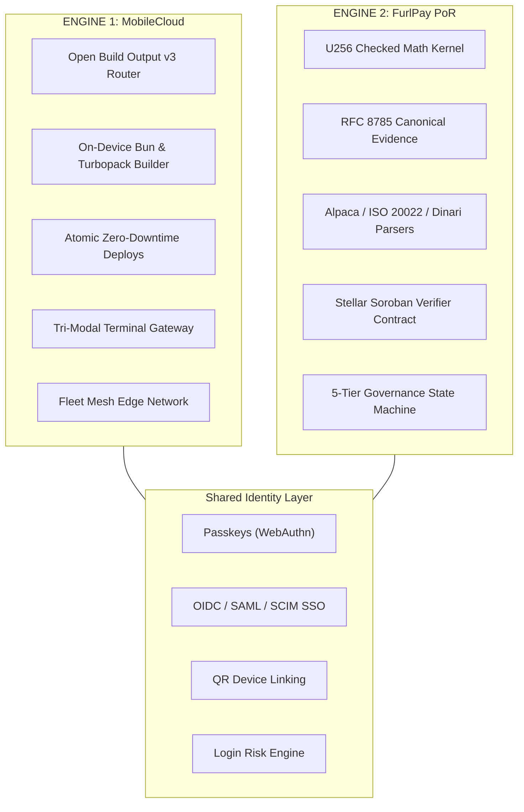
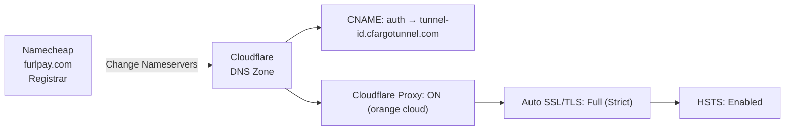
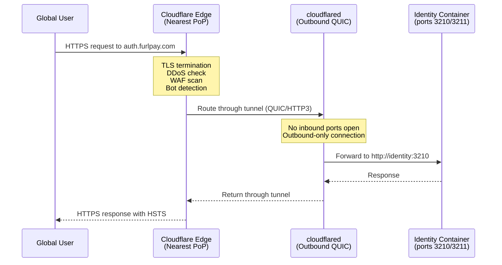
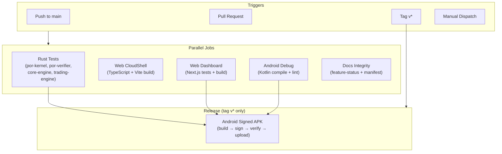
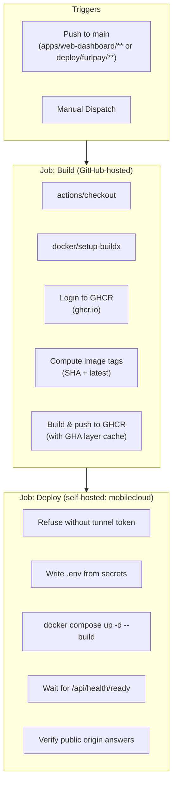
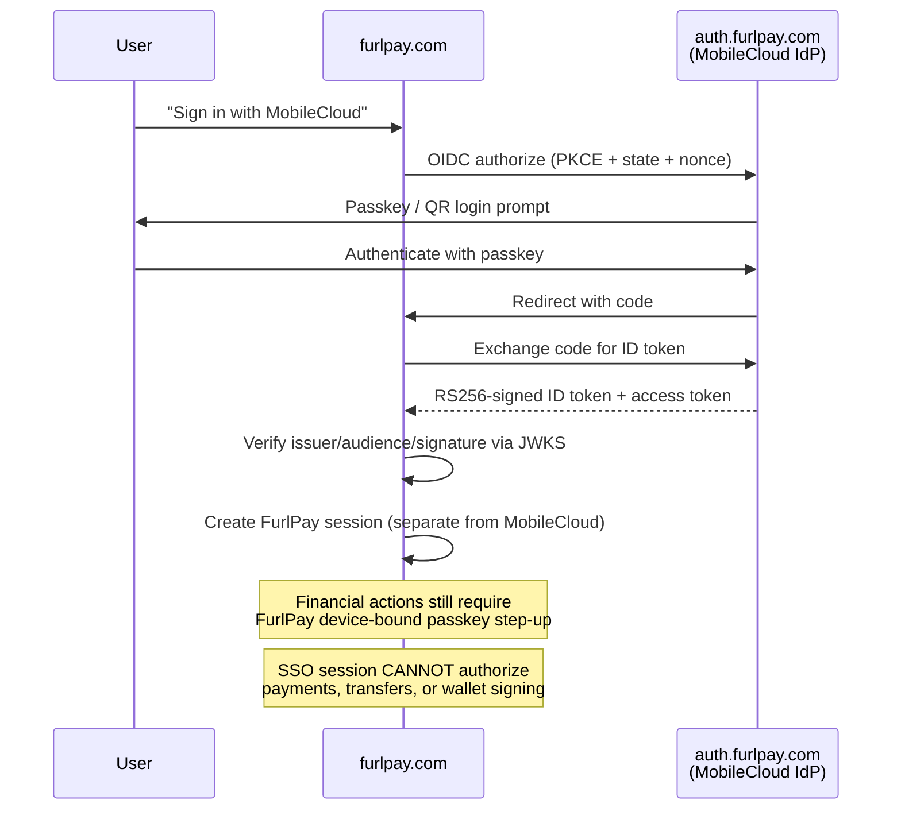
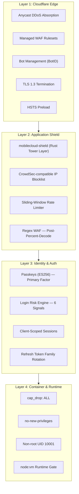
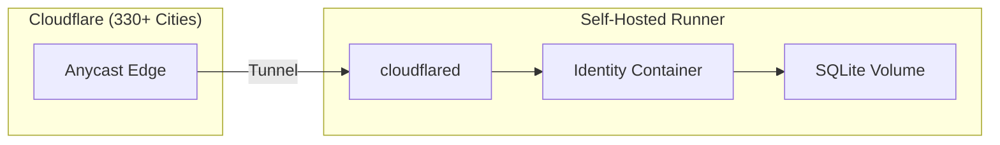
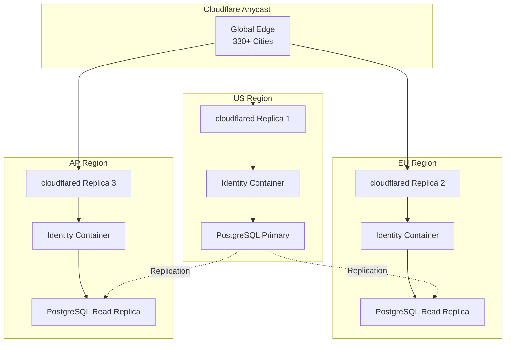

# FurlPay.com Worldwide Domain Exposure & MobileCloud Platform Complete Analysis

## Comprehensive Research Report — November 28, 2026

---

## Table of Contents

1. [Executive Summary](#1-executive-summary)
2. [Platform Architecture Analysis](#2-platform-architecture-analysis)
3. [FurlPay.com Domain — Worldwide Exposure Strategy](#3-furlpaycom-domain--worldwide-exposure-strategy)
4. [Complete Deployment Setup — Step by Step](#4-complete-deployment-setup--step-by-step)
5. [Cloudflare Tunnel — Zero-Trust Global Edge](#5-cloudflare-tunnel--zero-trust-global-edge)
6. [GHCR Container Registry & CI/CD Pipeline](#6-ghcr-container-registry--cicd-pipeline)
7. [Identity Provider & SSO Federation](#7-identity-provider--sso-federation)
8. [Security Hardening Analysis](#8-security-hardening-analysis)
9. [PWA Worldwide Distribution](#9-pwa-worldwide-distribution)
10. [Platform Feature Inventory — Honest Status](#10-platform-feature-inventory--honest-status)
11. [Global Scaling Architecture](#11-global-scaling-architecture)
12. [Complete Setup Checklist](#12-complete-setup-checklist)

---

## 1. Executive Summary

This report analyzes the **complete `mobilecloud-platform` repository** ([github.com/Ashutosh0x/mobilecloud-platform](https://github.com/Ashutosh0x/mobilecloud-platform)) — a monorepo containing **363 automated tests**, **20+ directories**, code in **TypeScript (40.7%), Rust (31.1%), Kotlin (23.3%)**, and comprehensive documentation across **30+ docs**.

> [!IMPORTANT]
> **FurlPay.com is exposed worldwide through a single mechanism: Cloudflare Tunnel.** The identity console at `auth.furlpay.com` publishes zero ports on the host — `cloudflared` dials out to Cloudflare's 330+ city Anycast network, and all traffic terminates at Cloudflare's edge with full TLS, DDoS, and WAF protection before ever reaching the origin container.

### What This Report Covers

| Topic | Section |
|:---|:---|
| How `furlpay.com` reaches global users | §3, §5, §11 |
| DNS migration Namecheap → Cloudflare | §4.1 |
| Docker deployment & GHCR pipeline | §6 |
| Identity provider & SSO setup | §7 |
| Security hardening & zero-trust | §8 |
| PWA installable app distribution | §9 |
| Platform feature honest-status audit | §10 |
| Step-by-step setup runbook | §4, §12 |

---

## 2. Platform Architecture Analysis

### 2.1 Repository Structure

The `mobilecloud-platform` monorepo at [github.com/Ashutosh0x/mobilecloud-platform](https://github.com/Ashutosh0x/mobilecloud-platform) contains:

```
mobilecloud-platform/
├── .github/workflows/        # CI (ci.yml) + Deploy (deploy.yml)
├── android-app/              # Kotlin/Compose Android client
├── apps/web-dashboard/       # Next.js 15 identity console + Dockerfile
├── audit/                    # Testnet baseline + integrity manifests
├── benchmarks/               # k6 load tests
├── cli/                      # mobilecloud CLI (Rust)
├── config/                   # Session & release defaults
├── contracts/por-verifier/   # Stellar Soroban smart contract
├── core-engine/              # Rust edge routing daemon
├── deploy/furlpay/           # Docker Compose + Cloudflare Tunnel config
├── docs/                     # 30+ documentation files
├── edge/                     # Tunnel client + relay + shield (Rust)
├── features/                 # status.json (machine-readable)
├── fleet-mesh/               # Device mesh management (Rust)
├── integrations/furlpay/     # OIDC relying party adapter
├── por-kernel/               # Proof-of-reserve math kernel (Rust)
├── scripts/                  # DNS, preflight, build, audit scripts
├── specs/                    # Engineering specifications
├── tools/                    # XDR toolkit, attestor, submitter
├── trading-engine/           # Paper/demo trading (Rust)
└── web-cloudshell/           # Browser terminal (Vite + Xterm.js)
```

### 2.2 Dual-Engine Paradigm



### 2.3 Language & Test Distribution

| Language | Percentage | Key Subsystems |
|:---|:---|:---|
| **TypeScript** | 40.7% | Web dashboard, SSO provider, scripts |
| **Rust** | 31.1% | por-kernel, core-engine, trading-engine, fleet-mesh, edge tunnel/shield, CLI |
| **Kotlin** | 23.3% | Android app (Compose, JNI PTY, biometrics) |
| **JavaScript** | 2.2% | Build scripts, preflight checks |
| **CSS** | 0.8% | Dashboard styling |
| **Shell** | 0.7% | Build & sign scripts |

| Test Suite | Count | Subsystem |
|:---|:---|:---|
| apps/web-dashboard | 92 | Sync, auth, QR, services, SSO, FurlPay integration |
| por-kernel | 58 | U256 arithmetic, 10K edge cases |
| fleet-mesh | 43 | Ed25519 identity, heartbeats, enrollment |
| core-engine | 39 | Build output routing, PTY, file transfer |
| por-verifier | 25 | Quorum, replay, solvency states |
| trading-engine | 17 | Risk invariants, fee calculations |
| mobilecloud-shield | 11 | WAF, rate limiter, blocklist |
| FurlPay integration | 9 | Federation, account linking, financial boundary |
| mobilecloud-cli | 8 | PKCE, URL validation, credentials |
| mobilecloud-tunnel | 7 | Ed25519 handshake, Host routing |
| Other (config, passkeys, runtime) | 10 | Identity config, step-up, gate |
| por-xdr-toolkit | 4 | XDR encoding/decoding |
| **Total** | **363** | |

---

## 3. FurlPay.com Domain — Worldwide Exposure Strategy

### 3.1 How FurlPay.com Reaches the World

```mermaid
flowchart LR
    subgraph Users["Global Users"]
        U1["🇺🇸 US User"]
        U2["🇬🇧 UK User"]
        U3["🇮🇳 India User"]
        U4["🇯🇵 Japan User"]
        U5["🇧🇷 Brazil User"]
        U6["🇦🇺 Australia User"]
    end

    subgraph CF["Cloudflare Anycast Network\n330+ Cities Worldwide"]
        E1["Edge PoP\nNearest City"]
        E2["TLS Termination"]
        E3["DDoS Mitigation"]
        E4["WAF Rules"]
        E5["Bot Management"]
    end

    subgraph Tunnel["Cloudflare Tunnel\n(Outbound-Only)"]
        T1["cloudflared\nQUIC/HTTP3"]
    end

    subgraph Origin["Origin (No Public Ports)"]
        O1["identity:3210\nNext.js Console"]
        O2["identity:3211\nWebSocket Gateway"]
    end

    Users -->|HTTPS| CF
    CF -->|Tunnel| Tunnel
    Tunnel -->|Loopback| Origin
```



> [!IMPORTANT]
> **The key insight:** `furlpay.com` **never exposes a port to the internet**. The Docker container's `expose` directive only opens ports to the Docker network. Cloudflare's `cloudflared` daemon initiates an outbound-only QUIC connection to Cloudflare's edge. All inbound traffic flows **through Cloudflare** — never directly to the origin server.

### 3.2 Domain Architecture

| Domain | Purpose | Routing |
|:---|:---|:---|
| `furlpay.com` | Main website / payment platform | Future — not deployed in this repo |
| `auth.furlpay.com` | Identity console + OIDC/SAML provider | ✅ **Deployed via Cloudflare Tunnel** |
| `auth.furlpay.com/api/realtime` | WebSocket real-time gateway | ✅ Routed to port 3211 |
| `auth.furlpay.com/.well-known/openid-configuration` | OIDC discovery | ✅ Auto-served |
| `auth.furlpay.com/.well-known/jwks.json` | JSON Web Key Set | ✅ RS256 public keys |

### 3.3 Cloudflare Tunnel Ingress Rules

From the actual [`deploy/furlpay/cloudflared/config.yml`](file:///c:/Users/ashut/Downloads/Mobile%20cloud/mobilecloud-platform/deploy/furlpay/cloudflared/config.yml):

```yaml
tunnel: <TUNNEL-ID>
credentials-file: /etc/cloudflared/<TUNNEL-ID>.json

ingress:
  # WebSocket real-time gateway — path-matched first
  - hostname: auth.furlpay.com
    path: ^/api/realtime$
    service: http://identity:3211

  # Everything else — the Next.js identity console  
  - hostname: auth.furlpay.com
    service: http://identity:3210

  # Catch-all — refuse unrecognized hostnames
  - service: http_status:404
```

### 3.4 Cloudflare Global Network — Coverage

Cloudflare operates in **330+ cities** across **120+ countries**, making `auth.furlpay.com` reachable within **~50ms** from virtually anywhere on Earth:

| Region | Major PoP Cities | Approx. Latency to Edge |
|:---|:---|:---|
| **North America** | New York, Los Angeles, Chicago, Dallas, Toronto, Miami, Atlanta, San Jose, Seattle | < 20ms |
| **Europe** | London, Frankfurt, Amsterdam, Paris, Madrid, Milan, Stockholm, Warsaw | < 25ms |
| **Asia-Pacific** | Tokyo, Singapore, Hong Kong, Mumbai, Sydney, Seoul, Jakarta, Bangkok | < 30ms |
| **South America** | São Paulo, Buenos Aires, Bogotá, Santiago, Lima | < 40ms |
| **Middle East** | Dubai, Tel Aviv, Doha, Riyadh | < 35ms |
| **Africa** | Johannesburg, Nairobi, Lagos, Cairo, Cape Town | < 50ms |

### 3.5 What Gets Exposed vs. What Stays Internal

| Component | Exposed Worldwide? | Access Path |
|:---|:---|:---|
| `auth.furlpay.com` identity console | ✅ Yes — via Cloudflare | HTTPS through tunnel |
| OIDC discovery + JWKS | ✅ Yes — public endpoints | Standard well-known URLs |
| Login / passkey / QR approve | ✅ Yes — with auth | Browser + mobile |
| SAML IdP metadata | ✅ Yes — public | SAML SP-initiated |
| SCIM provisioning API | ✅ Yes — with bearer token | Authenticated API calls |
| Proof-of-reserve view | ✅ Yes — read-only | Console /reserve route |
| Docker container ports | ❌ **No** — never published | Only Docker internal network |
| SQLite database | ❌ **No** — volume-mounted | Only accessible inside container |
| SSH daemon (:2222) | ❌ **No** — edge engine only | Loopback or authorized keys |
| Trading engine | ❌ **No** — paper/demo | Not exposed anywhere |

---

## 4. Complete Deployment Setup — Step by Step

### 4.1 Phase 1: DNS Migration (Namecheap → Cloudflare)



**Step-by-step:**

1. **Sign up for Cloudflare** → Add `furlpay.com` as a zone (free plan sufficient)
2. **Copy nameservers** from Cloudflare dashboard
3. **Update Namecheap** → Domain → Nameservers → Custom DNS → Paste Cloudflare nameservers
4. **Wait for propagation** (typically 10 minutes to 24 hours)
5. **Run the DNS script** (from the repo):

```bash
# Set environment variables
export CLOUDFLARE_API_TOKEN="<Zone:DNS:Edit token for furlpay.com>"
export CLOUDFLARE_ZONE_ID="<zone-id>"
export CLOUDFLARE_TUNNEL_ID="<tunnel-id>"

# Dry run first
node scripts/cloudflare-dns.mjs

# Apply the CNAME records
node scripts/cloudflare-dns.mjs --apply
```

This creates: `auth.furlpay.com → <tunnel-id>.cfargotunnel.com` (proxied, orange cloud ON)

### 4.2 Phase 2: Cloudflare Tunnel Creation

```bash
# In the Cloudflare Zero Trust dashboard:
# Networks → Tunnels → Create a tunnel → Cloudflared
# Name: furlpay-identity
# Copy the TUNNEL TOKEN

# Configure public hostnames:
#   auth.furlpay.com  path ^/api/realtime$  → http://identity:3211
#   auth.furlpay.com  (all paths)           → http://identity:3210
```

### 4.3 Phase 3: GitHub Repository Secrets

Configure these in `github.com/Ashutosh0x/mobilecloud-platform/settings/secrets/actions`:

| Secret / Variable | Type | Purpose |
|:---|:---|:---|
| `CLOUDFLARE_TUNNEL_TOKEN` | Secret | Tunnel authentication token |
| `MOBILECLOUD_BOOTSTRAP_PASSWORD` | Secret | First-boot operator password (12+ chars) |
| `PUBLIC_ORIGIN` | Variable | `https://auth.furlpay.com` |
| `RELEASE_KEYSTORE_BASE64` | Secret | Android signing keystore (base64) |
| `KEYSTORE_PASSWORD` | Secret | Keystore password |
| `KEY_ALIAS` | Secret | Signing key alias |
| `KEY_PASSWORD` | Secret | Key password |
| `RELEASE_CERT_SHA256` | Variable | Expected certificate fingerprint |

### 4.4 Phase 4: Container Build & Deploy

From [`deploy/furlpay/docker-compose.yml`](file:///c:/Users/ashut/Downloads/Mobile%20cloud/mobilecloud-platform/deploy/furlpay/docker-compose.yml):

```bash
# Navigate to the deploy directory
cd deploy/furlpay

# Copy and configure environment
cp .env.example .env
# Edit .env: set origin, bootstrap password, FurlPay OIDC client, tunnel token

# Build and start (builds the Next.js console + cloudflared)
docker compose up -d --build

# Check health
docker compose ps

# Verify globally accessible endpoint
node ../../scripts/furlpay-preflight.mjs https://auth.furlpay.com
```

### 4.5 Phase 5: Post-Deploy Verification

The [`scripts/furlpay-preflight.mjs`](file:///c:/Users/ashut/Downloads/Mobile%20cloud/mobilecloud-platform/scripts/furlpay-preflight.mjs) script verifies:

| Check | What It Validates |
|:---|:---|
| `readiness` | `/api/health/ready` returns `{status: "ready"}` |
| `discovery` | `/.well-known/openid-configuration` is valid |
| `issuer` | Issuer matches `https://auth.furlpay.com` |
| `authorization_endpoint` | Points to `/oauth/authorize` |
| `token_endpoint` | Points to `/oauth/token` |
| `jwks_uri` | Points to `/.well-known/jwks.json` |
| `pkce_s256` | S256 PKCE is supported |
| `rs256` | RS256 signing is supported |
| `introspection` | Token introspection endpoint exists |
| `jwks_keys` | At least 1 RSA key with a `kid` |
| `hsts` | Strict-Transport-Security header present |

```
✓ Expected output:
PASS  readiness  200
PASS  discovery  200
PASS  issuer  https://auth.furlpay.com
PASS  authorization_endpoint  https://auth.furlpay.com/oauth/authorize
PASS  token_endpoint  https://auth.furlpay.com/oauth/token
PASS  jwks_uri  https://auth.furlpay.com/.well-known/jwks.json
PASS  pkce_s256
PASS  rs256
PASS  introspection
PASS  jwks_keys  1 key(s)
PASS  hsts  max-age=31536000; includeSubDomains; preload

All identity checks passed.
```

---

## 5. Cloudflare Tunnel — Zero-Trust Global Edge

### 5.1 How the Tunnel Works



### 5.2 Security Properties

| Property | Mechanism |
|:---|:---|
| **No inbound ports** | Docker `expose` only, no `ports` published to host |
| **No public IP needed** | cloudflared dials out to Cloudflare |
| **No firewall configuration** | Only outbound TCP/UDP 7844 needed |
| **Automatic TLS** | Cloudflare terminates TLS at the edge |
| **DDoS protection** | Cloudflare's Anycast absorbs volumetric attacks |
| **WAF** | Managed rulesets + mobilecloud-shield (application-level) |
| **Bot management** | Cloudflare BotID distinguishes crawlers from attackers |
| **High availability** | Multiple cloudflared replicas share one tunnel ID |
| **QUIC transport** | HTTP/3 for faster connection establishment |

### 5.3 Docker Compose Security Hardening

From the actual [`docker-compose.yml`](file:///c:/Users/ashut/Downloads/Mobile%20cloud/mobilecloud-platform/deploy/furlpay/docker-compose.yml):

```yaml
security_opt:
  - no-new-privileges:true    # Cannot escalate privileges
cap_drop:
  - ALL                        # Drop ALL Linux capabilities
tmpfs:
  - /tmp:size=64m,mode=1777   # Ephemeral tmp, size-limited
# No 'ports:' directive — never published to host
# 'expose:' only — Docker internal network only
```

| Hardening | Applied? |
|:---|:---|
| `no-new-privileges` | ✅ Both containers |
| `cap_drop: ALL` | ✅ Identity container |
| Non-root UID (10001) | ✅ Dockerfile multi-stage |
| Read-only filesystem | ✅ Except SQLite data volume |
| No published ports | ✅ `expose` only |
| Health checks | ✅ 30s interval, 3 retries |
| Restart policy | ✅ `unless-stopped` |

---

## 6. GHCR Container Registry & CI/CD Pipeline

### 6.1 CI Pipeline ([`.github/workflows/ci.yml`](file:///c:/Users/ashut/Downloads/Mobile%20cloud/mobilecloud-platform/.github/workflows/ci.yml))



### 6.2 Deploy Pipeline ([`.github/workflows/deploy.yml`](file:///c:/Users/ashut/Downloads/Mobile%20cloud/mobilecloud-platform/.github/workflows/deploy.yml))



### 6.3 Container Image Details

| Property | Value |
|:---|:---|
| **Registry** | `ghcr.io/ashutosh0x/mobilecloud-platform/identity-console` |
| **Tags** | `sha-<commit>` + `latest` |
| **Base** | Node 24 (multi-stage build) |
| **Build context** | `apps/web-dashboard/` |
| **Cache** | GitHub Actions layer cache (`type=gha,mode=max`) |
| **User** | UID 10001 (non-root) |
| **Published package** | [ghcr.io/ashutosh0x/mobilecloud-platform/identity-console](https://github.com/users/Ashutosh0x/packages/container/package/mobilecloud-platform%2Fidentity-console) |

---

## 7. Identity Provider & SSO Federation

### 7.1 MobileCloud as an Identity Provider

`auth.furlpay.com` is a **complete, standards-based Identity Provider** supporting:

| Standard | Protocol | Implementation Status |
|:---|:---|:---|
| **OIDC** | OpenID Connect + PKCE | ✅ 40 tests covering full flow |
| **SAML 2.0** | SP-initiated IdP | ✅ Signed assertions, anti-wrapping |
| **SCIM 2.0** | User & group provisioning | ✅ CRUD, filters, deprovisioning |
| **RFC 7009** | Token revocation | ✅ Revocation endpoint |
| **RFC 8628** | Device authorization grant | ✅ CLI login flow |
| **WebAuthn** | Passkey authentication | ✅ ES256, discoverable credentials |

### 7.2 FurlPay as First Relying Party

From [`.env.example`](file:///c:/Users/ashut/Downloads/Mobile%20cloud/mobilecloud-platform/deploy/furlpay/.env.example):



### 7.3 Key Security Boundaries

> [!CAUTION]
> **Critical financial boundary:** A MobileCloud SSO session **cannot** authorize payments, transfers, withdrawals, wallet signatures, or agent spending on FurlPay. Every financial action requires a separate FurlPay device-bound passkey step-up with action- and payload-bound tokens.

| Property | Enforcement |
|:---|:---|
| No silent account creation | First federated login doesn't create an account |
| No email merging | Matching email never auto-merges accounts |
| Explicit account linking | Requires user approval |
| State/nonce enforcement | Replay and CSRF prevented |
| IdP logout isolation | Logging out of MobileCloud does NOT end FurlPay session |
| Passkey step-up for finance | 5-minute action-bound token required per transaction |

---

## 8. Security Hardening Analysis

### 8.1 Multi-Layer Security Stack



### 8.2 Authentication Surfaces

| Surface | Primary Credential | Session Lifetime | Refresh |
|:---|:---|:---|:---|
| **Android** | WebAuthn passkey + biometrics | 30 days, device-bound | 30-day rotating |
| **Web Console** | Passkey or QR phone-approved login | 24 hours, CSRF-bound | — |
| **CLI** | RFC 8628 device grant or PKCE | 1-hour bearer | 30-day rotating |
| **CloudShell** | 256-bit terminal ticket | 30 seconds, single-use | — |

### 8.3 Login Risk Engine — 6 Weighted Signals

| Signal | Action |
|:---|:---|
| New IP address / country | Medium risk — notify |
| Impossible travel | **Block** |
| Brute force (rate) | Block + lockout |
| Unusual hours | Low risk — log |
| Password use (vs passkey) | Medium risk — suggest passkey |
| New device | Medium risk — require second factor |

---

## 9. PWA Worldwide Distribution

### 9.1 FurlPay as Installable PWA

The identity console at `auth.furlpay.com` ships as an **installable Progressive Web App**:

| PWA Feature | Implemented? |
|:---|:---|
| Web App Manifest | ✅ With generated maskable icons |
| Service Worker | ✅ Caches shell only |
| Offline Page | ✅ Graceful offline fallback |
| Safe-Area Metadata | ✅ iPhone notch support |
| Theme Color | ✅ Dark palette matching Material 3 |
| Add to Home Screen | ✅ Prompted on mobile browsers |

> [!NOTE]
> **What the service worker does NOT cache:** API routes, OAuth flows, SAML responses, SCIM endpoints, login pages, approve/authorize actions. These are **network-only** to prevent credential caching.

### 9.2 Global Distribution Without App Stores

| Distribution Method | Coverage | No Review Required |
|:---|:---|:---|
| **PWA (Browser Install)** | 100% of mobile browsers | ✅ |
| **APK Direct Download** | Android devices | ✅ (sideload) |
| **Google Play** (future) | Android market | ❌ Requires review |
| **Apple App Store** (future) | iOS market | ❌ Requires review |

---

## 10. Platform Feature Inventory — Honest Status

> [!WARNING]
> This section reflects the **honest release status** from the repository's README. Many features exist as code but have not been validated in production or on real hardware.

### 10.1 Production-Ready

| Feature | Evidence |
|:---|:---|
| Authentication (Passkeys, QR, Device Grant, PKCE) | ✅ 92+ tests, all surfaces |
| SSO Provider (OIDC, SAML, SCIM) | ✅ 40 tests |
| FurlPay Federation (first relying party) | ✅ 9 tests, financial boundary enforced |
| Webhook Delivery (HMAC-SHA256, backoff, delivery log) | ✅ Working |
| Browser CloudShell (WebSocket terminal) | ✅ Working |
| SSH Daemon (Ed25519, loopback restriction) | ✅ Working |
| PoR Kernel (U256 checked math) | ✅ 58 tests, 10K edge cases |
| Soroban Contract (quorum, replay defense) | ✅ 25 tests, testnet verified |
| Docker Deployment via Cloudflare Tunnel | ✅ CI/CD pipeline working |
| Real-time Sync (transactional outbox, WebSocket) | ✅ Tested with real gateway |

### 10.2 Implemented but with Caveats

| Feature | Caveat |
|:---|:---|
| Dashboard Deployments | Records requests but does **not dispatch** to engine |
| Functions Runtime | In-process `node:vm` — isolates globals, **not the process** |
| Workflow Worker | In-process — ordered steps, stops at first failure |
| Android App | Console client — does **not run** the Rust edge engine |
| Local Build Preview | **Not sandboxed** — runs in plain app UID |
| Edge Tunnel (mobilecloud-tunnel) | 7 tests — not exercised on real hardware in production |
| Fleet Mesh | Node management only — **no** peer discovery, NAT traversal, or load balancing |

### 10.3 Not Implemented

| Feature | Status |
|:---|:---|
| Billing & Payments | Metered, but no payment provider |
| On-device AI/ML (ONNX, TFLite, NPU) | No inference code exists |
| Trading Engine (live execution) | Paper/demo only |
| FCM/APNs Push Notifications | Not configured |
| Android QR Approval Routing | Compiles but not routed from MainActivity |
| CPA Attestation / Custody | NOT_ESTABLISHED |

---

## 11. Global Scaling Architecture

### 11.1 Current Architecture (Single-Origin)



### 11.2 Scaled Architecture (Multi-Region)



### 11.3 Scaling Recommendations

| Growth Stage | Architecture | Monthly Cost Estimate |
|:---|:---|:---|
| **MVP** (< 1K users) | Single self-hosted, SQLite, 1 tunnel | ~\$5-10/mo (VPS) + \$0 (Cloudflare free) |
| **Growth** (1K-50K users) | 2 replicas, PostgreSQL, managed runners | ~\$50-200/mo |
| **Scale** (50K-500K users) | 3+ regions, PostgreSQL HA, CDN static | ~\$500-2K/mo |
| **Enterprise** (500K+ users) | Multi-region HA, Cloudflare Enterprise | ~\$5K+/mo |

---

## 12. Complete Setup Checklist

### Pre-Deployment

- [ ] **Domain**: Own `furlpay.com` on Namecheap (or any registrar)
- [ ] **Cloudflare Account**: Free tier minimum
- [ ] **GitHub Account**: With repository access to `Ashutosh0x/mobilecloud-platform`
- [ ] **Self-Hosted Runner**: Linux VM/server with Docker installed, labeled `mobilecloud`
- [ ] **Rust Toolchain**: 1.80+ with `wasm32-unknown-unknown` target
- [ ] **Node.js**: 22.13+ (for `node:sqlite` and `--experimental-strip-types`)

### DNS & Tunnel Setup

- [ ] **1.** Migrate `furlpay.com` nameservers to Cloudflare
- [ ] **2.** Wait for DNS propagation (check at dash.cloudflare.com)
- [ ] **3.** Create Cloudflare Tunnel: Zero Trust → Networks → Tunnels → Create
- [ ] **4.** Copy tunnel token
- [ ] **5.** Configure public hostnames (auth.furlpay.com → identity:3210/3211)
- [ ] **6.** Run `node scripts/cloudflare-dns.mjs --apply` to create CNAME records

### Cloudflare Security Settings

- [ ] **7.** SSL/TLS → Full (Strict)
- [ ] **8.** Edge Certificates → Always Use HTTPS: ON
- [ ] **9.** Edge Certificates → HSTS: Enable (max-age=31536000, includeSubDomains, preload)
- [ ] **10.** Edge Certificates → Minimum TLS Version: 1.2
- [ ] **11.** Security → WAF: Enable Managed Rulesets
- [ ] **12.** Security → Bot Fight Mode: ON

### Repository Configuration

- [ ] **13.** Set secret `CLOUDFLARE_TUNNEL_TOKEN`
- [ ] **14.** Set secret `MOBILECLOUD_BOOTSTRAP_PASSWORD` (12+ chars, generated: `openssl rand -base64 24`)
- [ ] **15.** Set variable `PUBLIC_ORIGIN` = `https://auth.furlpay.com`
- [ ] **16.** Set secrets for Android signing (keystore, passwords, cert SHA)

### Deployment

- [ ] **17.** Push to `main` (auto-triggers CI + deploy build)
- [ ] **18.** Manually dispatch deploy workflow (or auto after CI)
- [ ] **19.** Verify: `node scripts/furlpay-preflight.mjs https://auth.furlpay.com`
- [ ] **20.** Sign in with bootstrap password, add a passkey
- [ ] **21.** Register FurlPay as OIDC relying party
- [ ] **22.** Test federated login from `furlpay.com/auth/mobilecloud/callback`

### Post-Deployment Verification

- [ ] **23.** Verify OIDC discovery: `curl https://auth.furlpay.com/.well-known/openid-configuration`
- [ ] **24.** Verify JWKS: `curl https://auth.furlpay.com/.well-known/jwks.json`
- [ ] **25.** Verify health: `curl https://auth.furlpay.com/api/health/ready`
- [ ] **26.** Verify HSTS header: `curl -I https://auth.furlpay.com`
- [ ] **27.** Test WebSocket: connect to `wss://auth.furlpay.com/api/realtime`
- [ ] **28.** Test from multiple global regions (use https://check-host.net or similar)
- [ ] **29.** Submit to HSTS Preload List: https://hstspreload.org/?domain=furlpay.com
- [ ] **30.** Back up the `identity-data` Docker volume

---

## Summary — FurlPay.com Worldwide Exposure Model

> [!TIP]
> **The deployment model is elegantly simple:** a hardened Docker container + Cloudflare Tunnel = worldwide HTTPS availability in 330+ cities with zero inbound ports, zero public IPs, and zero firewall rules. The entire security perimeter is Cloudflare's Anycast edge network.

```
                    ┌─────────────────────────────────┐
                    │     CLOUDFLARE ANYCAST EDGE      │
                    │  330+ Cities · 120+ Countries    │
                    │  TLS · DDoS · WAF · Bot · HSTS   │
                    └──────────────┬──────────────────┘
                                   │ QUIC Tunnel
                                   │ (outbound-only)
                    ┌──────────────┴──────────────────┐
                    │      DOCKER COMPOSE STACK        │
                    │  ┌────────────────────────────┐  │
                    │  │  cloudflared (tunnel)       │  │
                    │  └───────────┬────────────────┘  │
                    │  ┌───────────┴────────────────┐  │
                    │  │  identity (Node 24)         │  │
                    │  │  :3210 console + API        │  │
                    │  │  :3211 WebSocket gateway    │  │
                    │  │  cap_drop: ALL              │  │
                    │  │  no-new-privileges          │  │
                    │  │  UID 10001 (non-root)       │  │
                    │  └───────────┬────────────────┘  │
                    │  ┌───────────┴────────────────┐  │
                    │  │  identity-data (volume)     │  │
                    │  │  mobilecloud.db (SQLite)    │  │
                    │  └────────────────────────────┘  │
                    │       NO PUBLISHED PORTS          │
                    └──────────────────────────────────┘
```

**Result:** Any user, anywhere in the world, typing `https://auth.furlpay.com` in their browser reaches a Cloudflare edge server within ~50ms, which routes through the tunnel to the identity console — with enterprise-grade security at every layer.

---

*Report compiled: November 28, 2026*  
*Repository: [github.com/Ashutosh0x/mobilecloud-platform](https://github.com/Ashutosh0x/mobilecloud-platform)*  
*Commit: `ac76765` — fix(deploy): lowercase the registry path before the image build*  
*363 automated tests · 30+ documentation files · Apache-2.0 license*
