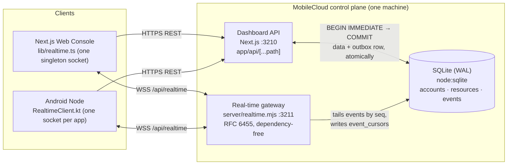

# Real-Time Synchronization — Web Console ⇄ Android Node

Status tags: **[DEPLOYED]** where an automated end-to-end test in this repository
exercises the claim · **[VERIFIED_SOURCE]** where the implementation exists and
is covered by source-level contracts but is not exercised by a live client in CI.

This document is the engineering reference for the unified Web + Android
synchronization plane. It is intentionally concrete: every table, message and
endpoint below exists in the repository today.

---

## 1. Objective

The Next.js web console and the Android node are **two clients of one backend**.
One account, one authoritative data model, one event log. An action taken in
either client becomes visible in the other without a manual refresh.

Nothing here is simulated: mutations write rows, rows produce events, events
travel over an authenticated socket, and any client that missed traffic
recovers it from the same durable log.

---

## 2. Process model

The dashboard API and the real-time gateway are **separate processes that share
one SQLite file**. They must be separate: a Next.js route handler cannot answer
an HTTP `upgrade` request, so the WebSocket listener runs on its own port and
reads the same WAL database.



| Process | Default port | Env override | Role |
| :--- | :--- | :--- | :--- |
| Dashboard API | `3210` | `--port` / `MOBILECLOUD_PORT` | REST mutations, auth, `/api/health`, `/api/sync/changes` |
| Real-time gateway | `3211` | `MOBILECLOUD_REALTIME_PORT` | Authenticated WebSocket, event fan-out, cursor replay |

Both are started together by `npm run dev` / `npm start` (`node server/run.mjs`).
The API advertises the gateway in its health payload so clients never hard-code
the port:

```json
{
  "service": "MobileCloud",
  "realtime": {
    "transport": "websocket",
    "path": "/api/realtime",
    "port": 3211,
    "fallback": "/api/sync/changes",
    "schemaVersion": 1
  }
}
```

---

## 3. Storage — the transactional outbox

The outbox is not an optimisation, it is the correctness mechanism. If a change
were only ever announced over a socket, a client that was asleep would lose it
permanently. Because the event row commits **in the same transaction** as the
data change, "the change happened" and "the event exists" cannot disagree.

```sql
CREATE TABLE events (
  seq            INTEGER PRIMARY KEY AUTOINCREMENT,  -- global ordering
  id             TEXT NOT NULL UNIQUE,               -- UUID, the dedupe key
  owner_id       TEXT NOT NULL,                      -- authorization scope
  type           TEXT NOT NULL,                      -- event_type
  resource_id    TEXT,                               -- project / deployment / …
  schema_version INTEGER NOT NULL DEFAULT 1,
  payload        TEXT NOT NULL DEFAULT '{}',
  at             INTEGER NOT NULL                    -- epoch ms
);
CREATE INDEX idx_events_owner_seq ON events (owner_id, seq);

CREATE TABLE event_cursors (
  consumer TEXT PRIMARY KEY,   -- e.g. 'realtime-gateway'
  seq      INTEGER NOT NULL,
  at       INTEGER NOT NULL
);
```

* `publish(db, ownerId, type, resourceId, payload)` appends one row and returns
  its `seq`. It is only ever called inside `tx(db, fn)`.
* `tx()` uses `BEGIN IMMEDIATE`, so two concurrent mutations serialize instead of
  interleaving and producing a non-monotonic log.
* Retention: `prune()` drops events older than **30 days** or beyond the newest
  **50,000** rows.
* Writers use `PRAGMA busy_timeout = 4000`; the API and the gateway are two
  processes on the same file and must wait, not fail with `SQLITE_BUSY`.

**Recovery guarantee:** a client that reconnects with cursor `C` receives every
event with `seq > C` that belongs to its account, in ascending order, oldest
first — no matter how long it was away.

---

## 4. Event envelope

Every event, whether pushed over the socket or replayed by the REST endpoint,
has exactly this shape ([`lib/server/events.ts`](../apps/web-dashboard/lib/server/events.ts)):

```json
{
  "event_id": "0f6c1c4e-…",
  "event_type": "project.created",
  "schema_version": 1,
  "account_id": "acc_…",
  "resource_id": "prj_…",
  "sequence": 1024,
  "occurred_at": "2026-11-24T09:14:02.331Z",
  "payload": { "name": "edge-router", "runtime": "node" }
}
```

`sequence` is the outbox `seq`: a single monotonic counter for the whole
platform. Clients use it for ordering, gap detection and cursor bookkeeping.
`event_id` is the idempotency key; `account_id` is the authorization scope.

---

## 5. Event catalogue

| Event type | Emitted when | `resource_id` |
| :--- | :--- | :--- |
| `account.updated` | display name, password, plan, or preferences change | account |
| `session.created` | a new API token / device session is issued | token |
| `session.revoked` | a token is deleted or an account logs out everywhere | token |
| `project.created` / `project.updated` / `project.deleted` | project lifecycle | project |
| `deployment.started` / `deployment.updated` / `deployment.completed` / `deployment.failed` | deployment lifecycle | deployment |
| `build.started` / `build.updated` / `build.completed` /`build.failed` | build lifecycle | build |
| `configuration.updated` | server or account configuration changes | account |
| `notification.created` / `notification.read` | inbox changes | notification |
| `server.status_changed` | gateway/agent comes up or goes down | server |

All 18 types are enumerated in `EVENT_TYPES`; subscriptions are validated
against that list, so a client cannot subscribe to a type that does not exist.

---

## 6. WebSocket gateway protocol

**Endpoint:** `wss://<control-plane-host>/api/realtime` — in local development
`ws://127.0.0.1:3211/api/realtime`.

**Authentication** happens in the HTTP upgrade, before any frame is exchanged:

| Credential | How it is presented | Use |
| :--- | :--- | :--- |
| Browser session | `mc_session` cookie (HttpOnly, SameSite=Lax) | web console |
| API token | `Authorization: Bearer mc_…` | Android, agents, scripts |
| Fallback | `?token=mc_…` query parameter | clients that cannot set headers |

Tokens are looked up by SHA-256 digest — the raw secret is never stored or
logged. An upgrade without valid credentials is rejected; a rejected upgrade is
distinguishable from an unreachable host, so the client never reports a network
failure for an authentication problem.

### Client → server

| Message | Meaning |
| :--- | :--- |
| `{"type":"hello","cursor":1024}` | Identifies the client and declares its last known sequence |
| `{"type":"subscribe","types":["project.updated"]}` | Narrows the stream (omit `types` for everything) |
| `{"type":"unsubscribe","types":[…]}` | Removes a subscription |
| `{"type":"ping"}` | Liveness probe |
| `{"type":"ack","sequence":1024}` | Acknowledges delivery up to `sequence` |
| `{"type":"sync","cursor":1024}` | Requests replay of everything after the cursor |

### Server → client

| Message | Meaning |
| :--- | :--- |
| `{"type":"welcome","account_id":…,"cursor":…,"schema_version":1}` | Upgrade accepted; server's current sequence |
| `{"type":"event","event":{…}}` | One event envelope |
| `{"type":"replay_start"}` / `{"type":"replay_complete","cursor":…}` | Bracket a catch-up burst |
| `{"type":"replay_incomplete","cursor":…}` | Replay hit its page limit — the client must continue over REST |
| `{"type":"delivered","sequence":…}` | Server-side acknowledgement |
| `{"type":"pong"}` | Heartbeat reply |
| `{"type":"server.status","status":"online"}` | Broadcast on gateway start/shutdown |
| `{"type":"error","message":…}` | Protocol or authorization error |

**Delivery rules.** Every `event` frame is sent only to sockets authenticated as
that `owner_id`; a client can never observe another account's traffic, because
the tailer query is scoped by owner and the subscription matcher runs after that
scope is applied.

**Limits.** 256 KB maximum frame · 12 concurrent sockets per account · 500 total ·
240 messages per 10-second window per socket · 500-event replay page · 75 s
client timeout, 20 s server heartbeat.

---

## 7. Cursor synchronization over REST

```http
GET /api/sync/changes?cursor=1024&limit=500
```

```json
{
  "account_id": "acc_…",
  "cursor": 1500,
  "latest": 1500,
  "more": false,
  "events": [ { "event_id": "…", "sequence": 1025, "…": "…" } ]
}
```

* `cursor` is the client's last known sequence; omit it for "everything you have".
* `limit` is clamped to a maximum of 1000.
* `more: true` means the client should immediately call again with the returned
  `cursor` until it reaches `latest`.
* The response is **authorized**: rows are filtered by the authenticated
  account, so this endpoint cannot be used to read another tenant's log.
* Unauthenticated calls return `401`.

This endpoint is the whole reason a 30-minute offline period is survivable. It is
also the bounded fallback when WebSockets cannot be established.

---

## 8. Client behaviour

Both clients implement the same contract independently:

| Concern | Web (`lib/realtime.ts`) | Android (`RealtimeClient.kt`) |
| :--- | :--- | :--- |
| Socket count | one singleton for the whole app | one for the whole app |
| Transport | browser `WebSocket` | `java.net.Socket` + RFC 6455 framing, `SSLSocketFactory` for `wss` |
| Endpoint | from `/api/health` | from `/api/health` |
| Auth | existing session cookie | `mc_session` cookie from `CookieManager`, or bearer token |
| Reconnect | exponential backoff with full jitter, cap 30 s | same, `min(30 s, 500 ms · 2ⁿ)` with jitter |
| Heartbeat | `ping` every 25 s, dead peer at 75 s | `ping` every 20 s, `SO_TIMEOUT` 75 s |
| Ordering | `sequence` comparison | `sequence` comparison |
| Dedupe | `event_id` set, 2,000 entries | `event_id` `LinkedHashSet`, 2,000 entries |
| Gap recovery | detects `sequence > cursor + 1` → REST catch-up | identical |
| Cursor | `localStorage` | `SharedPreferences` (`realtime_cursor`) |
| Fallback | bounded polling after 4 consecutive failures | slower full refresh when not `CONNECTED` |
| Network change | `online` / `offline` / `visibilitychange` | `ConnectivityManager.NetworkCallback` |

**Optimistic UI.** The web console's `call(path, init, optimistic)` applies a
local patch immediately, **rolls the entire data slice back** if the server
rejects the mutation, and reconciles against the authoritative snapshot once the
request succeeds. It is wired into the mutations where latency is most visible:
mark-notification-read, delete project, delete hostname, delete firewall rule.

**Realtime events are not the only record.** Web and Android both re-pull the
authoritative snapshot on a live event (debounced 250 ms), so a missed frame
degrades into a slightly later refresh rather than a wrong screen.

---

## 9. Android endpoint discovery

`adb reverse tcp:3210 tcp:3210` is a **development convenience, not a
requirement**. The node finds its control plane on its own, in this order:

1. the endpoint validated earlier in this session (runtime cache),
2. the address stored from a previous run — **revalidated, never trusted**,
3. loopback (`127.0.0.1`, `localhost`) — what a USB cable reaches after an
   explicit `adb reverse`,
4. the emulator host alias `10.0.2.2`,
5. every host on the device's own `/24` (Wi-Fi, hotspot, or VPN).

Rules that make it deterministic:

| Rule | Value |
| :--- | :--- |
| Candidates with a reason to exist (stored / loopback / emulator) | 3 s per candidate |
| Bulk `/24` sweep (≈500 candidates) | 800 ms per candidate, 48 in parallel |
| Whole search | bounded by an **8 s budget**, then cancelled |
| Single-flight | a burst of callers shares one sweep, never runs several |
| Validation | `/api/health` must answer as MobileCloud; `/api/overview` fallback for older control planes |
| Caching | only a validated endpoint is cached |
| Blank values | never overwrite a working address |
| Network change | the cache is invalidated so a stale LAN address is not reused |

**Connection state machine** (`ConnectionState`): `INITIALIZING`, `DISCOVERING`,
`CONNECTED`, `AUTH_REQUIRED`, `NETWORK_UNAVAILABLE`, `SERVER_UNAVAILABLE`,
`INVALID_ENDPOINT`, `AUTHENTICATION_FAILED`.

The distinctions matter and are enforced in code:

* `401` → `AUTH_REQUIRED`, never "unreachable";
* `403` / rejected credentials → `AUTHENTICATION_FAILED`, never a re-discovery;
* a host that answers with something other than MobileCloud → `INVALID_ENDPOINT`;
* no usable radio → `NETWORK_UNAVAILABLE` (the device is at fault);
* radio up, nothing listening → `SERVER_UNAVAILABLE` (firewall / server stopped).

The console surfaces this in a diagnostics panel: status, realtime state,
transport, endpoint, connection method (loopback vs validated LAN vs HTTPS),
account, device, last health check, last sync, cursor, pending changes, last
error, plus **Retry**, **Change server** and **Auto-detect**. A `CONNECTED` label
is only shown after an authenticated session has actually answered.

---

## 10. Cross-device authentication

Browser cookies are **never** copied to Android. Both clients end up with the
same *identity* through the platform's existing credential system:

* web console: `mc_session` cookie issued by `auth/login`;
* Android: the same endpoint, session persisted in the app, cookies handled by
  `CookieManager`; long-lived automation uses `POST /api/tokens` → `mc_…` bearer
  tokens stored as SHA-256 digests.

Revocation is server-side and shared: deleting a token or changing the password
invalidates the session for **every** device, and `session.revoked` is published
so connected clients learn about it without polling. Passwords and long-lived
secrets are never carried inside WebSocket messages — the socket carries only the
upgrade credential and event envelopes.

---

## 11. Reliability, limits and observability

* Exponential backoff with full jitter on both clients; no thundering herd after
  a server restart.
* Heartbeats both directions; a half-open socket is detected and recycled.
* Event batching is server-side: replay is paged, never a single unbounded frame.
* Message size cap (256 KB), per-account and global socket caps, and a per-socket
  rate limit bound the damage a misbehaving client can do.
* `sqlite` WAL + `busy_timeout` + `BEGIN IMMEDIATE` keep the two processes
  consistent under concurrent writes.
* `event_cursors` records how far the gateway has tailed, so a gateway restart
  resumes rather than skips.
* Structured lines are logged by both the API and the gateway (connection,
  upgrade rejection, replay start/complete, disconnect) and the health payloads
  (`:3210/api/health`, `:3211/api/health`) report live client and account counts.

---

## 12. Test coverage

Automated (`npm test` in `apps/web-dashboard`, 14 tests — 9 of them cover this
document):

| Scenario (master prompt) | Where it is proven |
| :--- | :--- |
| Health advertises the realtime transport | `lib/server/events.test.ts` |
| Mutation writes a durable outbox row | `lib/server/events.test.ts` |
| A mutation reaches a connected socket in real time | `lib/server/realtime.test.ts` |
| Anonymous upgrade is rejected | `lib/server/realtime.test.ts` |
| Cross-account isolation (A never sees B) | `lib/server/realtime.test.ts`, `lib/server/events.test.ts` |
| Unauthenticated `GET /api/sync/changes` → 401 | `lib/server/events.test.ts` |
| Offline client recovers every missed change, in order | `lib/server/events.test.ts` |
| Reconnect replays missed changes once, exactly | `lib/server/realtime.test.ts`, `lib/server/events.test.ts` |
| Duplicate delivery is idempotent (no-op sync, `event_id` dedupe) | `lib/server/events.test.ts` |

The gateway under test is the real `server/realtime.mjs` spawned as a child
process against a temporary database — not a mock.

**[VERIFIED_SOURCE], not yet automated:** backend-restart reconnection (F),
login/logout session invalidation across two devices (G/H), competing edits to
the same resource (I), and the mobile-data → Wi-Fi transition (K). These paths
exist in both clients; they are listed as manual scenarios rather than claimed
as CI-verified.

---

## 13. Honest limitations

* **Conflict handling is last-write-wins.** Two devices editing the same resource
  resolve by SQLite transaction order, and both clients converge on the
  resulting snapshot. There is no field-level merge and no user-visible conflict
  prompt; the event carries the winning value, and `sequence` is the version.
* **One control plane per database file.** Horizontal scaling would need a real
  message broker; the outbox is deliberately a single-node design.
* **Android cannot hold a socket forever.** Doze and background restrictions
  suspend the process; the cursor makes the gap harmless, and deferred catch-up
  happens on resume or via `WorkManager`.
* **No packaged public tunnel.** Remote (different network, no USB) access needs
  a secure path you control — WireGuard/Tailscale, or an HTTPS/WSS reverse proxy
  in front of the control plane. Discovery cannot cross unrelated networks by
  design, and the local port must not be exposed to the internet unprotected.
