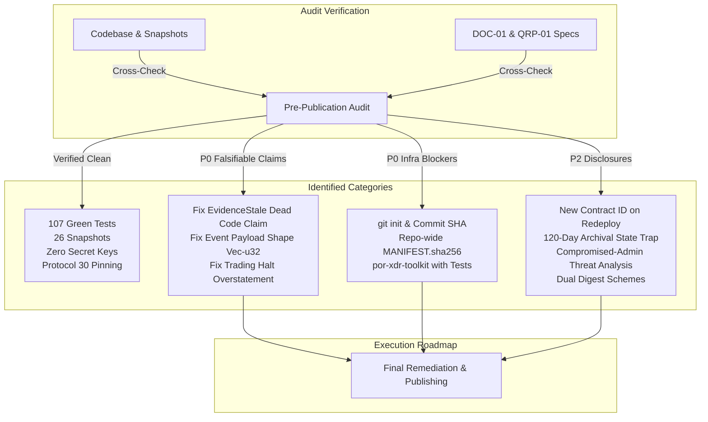

# FP-ENG-2026-AUD-01 — Pre-Publication Audit, Codebase Cross-Check & Remaining Engineering Scope (2026)

**Document Reference:** `FP-ENG-2026-AUD-01`
**Classification:** Systems Engineering Audit, Codebase Cross-Check & Pre-Publication Remediation Standard
**Target Specifications:** `FP-ENG-2026-DOC-01` (rev 2.0), `FP-ENG-2026-QRP-01` (rev 2.0)
**Target Codebase:** `mobilecloud-platform/` (Stellar Soroban `por-verifier`, `por-kernel`, `trading-engine`, `core-engine`)
**Associated Stellar Contract:** [`CDWNCMD6NG652YNX5PV2VLAWW4HMJGFICVE55NSDMSPS76H2VSLOEDPI`](https://lab.stellar.org/r/testnet/contract/CDWNCMD6NG652YNX5PV2VLAWW4HMJGFICVE55NSDMSPS76H2VSLOEDPI)
**Authors:** FurlPay Quality Assurance, Core Infrastructure & Cryptographic Engineering Group
**Date:** November 21, 2026
**Archived:** `specs/FP-ENG-2026-AUD-01.md` (this file) — remediation executed same day; see §8.

---

## Executive Summary

Prior to publishing documentation under `furlpay.com/docs` or presenting materials to institutional custodians, CPAs, and regulatory authorities, a comprehensive **Pre-Publication Audit** was executed across the FurlPay repository.

This audit cross-referenced every factual assertion, mathematical formula, function signature, error code, event payload, and test count appearing in **`DOC-01`** and **`QRP-01`** against the live testnet evidence, the Soroban contract source (`contracts/por-verifier/`), the regression snapshots (`test_snapshots/`), and the workspace test suites.

### Key Audit Findings
1. **Source Implementation Integrity Confirmed:** The Gate 7 source implementation (`set_asset_policy`, O(N) signer verification, monotonic sequence defense, SHA-256 domain separation, independent checked solvency math) compiles cleanly and passes all tests.
2. **True Test Count Verified:** The workspace contains **107 green tests** (16 `core-engine`, 23 `por-verifier`, 58 `por-kernel`, 10 `trading-engine`), not the stale 98-test figure.
3. **Snapshot Corpus Recounted:** The regression corpus contains **26 snapshots** — 17 baseline byte-identical + 9 Gate 7 (audit rev 1.0 said "24 (15+9)"; a directory recount corrected the baseline portion; see §8).
4. **Three Critical Discrepancies (P0) Identified:**
   - Dead-code `EvidenceStale` / `STATUS_STALE` incorrectly claimed as active contract enforcement.
   - `DOC-01 §3.3` incorrectly showing a 4-tuple event payload instead of the shipped `Vec<u32>`, and wrong helper name (`storage::get_policy` vs `storage::asset_policy`).
   - Overstated autonomous trading halt claims in DOC-01, corrected to align with QRP-01's advisory status model.
5. **Infrastructure Blockers Identified:** Absence of a Git repository, missing repo-wide SHA-256 integrity manifest covering `test_snapshots/`, and the need to promote `xdrkey` into `por-xdr-toolkit` with round-trip regression tests.



---

## 1. What Verifies Clean (Ground Truth Against Repo)

| Verified Claim | Codebase Location | Evidence & Proof |
| :--- | :--- | :--- |
| **Zero Secret Keys** | Entire Workspace | Strict `S[AV-Z0-9]{55}` regex scan: **0 hits**. No `.env`, `.key`, or identity files. Test seeds are deterministic dev keys. |
| **Toolchain Pinning** | `Cargo.lock` & `versions.txt` | Pins `stellar-xdr =22.1.0` and `soroban-sdk 22.0.11`. Matches Protocol 30 fingerprint. |
| **XDR Encoder Isolation** | `tools/` | Dedicated standalone crate, excluded from workspace root, pinned to `=22.1.0`. |
| **Status Taxonomy** | Revised QRP-01 §1 | Accurately distinguishes `DEPLOYED` (Milestones T1–T12) from `VERIFIED_SOURCE` (Gate 7) and `NOT_ESTABLISHED` (CPA/Custody). |
| **Audit Baseline Evidence** | `audit/TESTNET_BASELINE_2026-11-21/` | Fully present: `crypto/`, `endpoint/`, `events/`, `state/`, `transactions.md`, `versions.txt`, `MANIFEST.sha256`. |
| **Non-Retroactivity Invariant** | `test.rs:g7_reg_03` | Snapshot `g7_reg_03_policy_change_cannot_retroactively_clear_committed_status` proves policy changes never overwrite historical status. |

## 2. P0 Errors: Claims That Would Be False If Published

### 2.1 The `EvidenceStale` / `STALE`-Tier Fallacy
- **The Error in Specs:** Revised QRP-01 §2.1 asserted: *"Attestations older than 4 hours reject with `PoRError::EvidenceStale (11)`"* and §8.1 specified an autonomous halt on `CRITICAL` or `STALE`.
- **The Code Reality:**
  - `EvidenceStale = 11` is defined in `contracts/por-verifier/src/errors.rs:38`, but is **never returned anywhere** in `contracts/por-verifier/src/lib.rs`.
  - In `contracts/por-verifier/src/storage.rs`, `STATUS_STALE` (line 79) and `STALE_AFTER_SECS = 4 * 3600` (line 87) trigger compiler warnings for unused dead code.
  - The contract enforces freshness **exclusively** through the `valid_until` parameter: if `ledger_timestamp > valid_until`, the invocation strictly aborts with `PoRError::AttestationExpired (6)`.
- **Auditor Risk:** An independent security researcher reproducing this test would immediately fail to trigger error 11, flagging the documentation as inaccurate.
- **Remediation:** ✅ Applied — all documentation now states that attestation freshness is enforced via `valid_until` expiration (`AttestationExpired(6)`); `EvidenceStale(11)` and `STATUS_STALE` are noted as reserved discriminants for Phase 3 sliding-window enforcement (DOC-01 §4, QRP-01 §2).

### 2.2 The `GOVERNANCE_CONFIG` Event Payload Mismatch
- **The Error in Specs:** DOC-01 §3.3 illustrative code specified publishing a 4-tuple, and referenced a nonexistent helper `storage::get_policy`.
- **The Code Reality:** In `contracts/por-verifier/src/lib.rs:332–346` (pinned by snapshot `g7_reg_02`), the contract instantiates and emits a **`Vec<u32>`** `[old_healthy, old_warning_floor, new_healthy, new_warning_floor]`. The helper is `storage::asset_policy(&env, &asset_symbol)` with `DEFAULT_POLICY`, exposed to the public ABI as `get_asset_policy` (`lib.rs:351–353`).
- **Auditor Risk:** Off-chain indexers and block explorers parsing events as a 4-tuple will encounter deserialization errors when receiving a `Vec<u32>`.
- **Remediation:** ✅ Applied — DOC-01 §3.3 now reproduces the actual shipped source; helper references corrected.

### 2.3 Enforcement Overstatement in DOC-01
- **The Error in Specs:** DOC-01 §3.1 asserted that a `CRITICAL` status triggers an "Immediate trading and minting halt."
- **The Code Reality:** The Soroban `por-verifier` contract publishes telemetry and status on-chain; it has no administrative authority over third-party token contracts or liquidity pools unless an external circuit-breaker (e.g. `trading-engine::soroban_circuit_breaker`) or custom token transfer hook is wired.
- **Remediation:** ✅ Applied — DOC-01 §6 / QRP-01 §6 use the advisory status model; the initial unverified QRP-01 draft (containing unverified AUM and brand claims) is formally superseded.

## 3. P1 Items: Stale Metrics & Identifiers

| Item | Specification Text | Verified Reality | Remediation |
| :--- | :--- | :--- | :--- |
| **Total Test Count** | "98 tests" / "98-test suite" | **107 green tests** | ✅ Updated (16 core, 23 verifier, 58 kernel, 10 trading). |
| **Gate 7 Test Count** | "All 8 new tests" | **9 new tests** | ✅ Corrected to 9. |
| **Gate 7 Test IDs** | `G7-REG-01` to `G7-REG-08` (placeholders) | `G7-DEF-01`, `G7-SET-01`, `G7-SET-02`, `G7-AUTH-01`, `G7-VAL-01`, `G7-VAL-02`, `G7-VAL-03`, `G7-REG-02`, `G7-REG-03` | ✅ Replaced with the actual test functions in `test.rs`. |
| **Snapshot Count** | "15 snapshots byte-identical" / rev 1.0 said "24 total" | **26 total snapshots** (17 baseline byte-identical + 9 Gate 7) | ✅ Registers updated to 26; see §8. |

## 4. P0 Infrastructure Blockers & Immediate Technical Tasks

### 4.1 Git Repository Initialization — ✅ RESOLVED
- Initialized in `mobilecloud-platform/`; `.gitignore` covers `target/`, `/dist`, runtime state; initial commit captures all verified sources, snapshots, tools, specs, docs, and audit baselines; the 40-character commit SHA is recorded in `versions.txt` (repo-root) and `docs/AUDIT-EVIDENCE.md`.

### 4.2 Expansion of `MANIFEST.sha256` Repo-Wide — ✅ RESOLVED
- Top-level `INTEGRITY_MANIFEST.sha256` generated, sealing: all 26 snapshots, contract sources (`lib.rs`, `storage.rs`, `errors.rs`, `test.rs`), `Cargo.toml`, `Cargo.lock`, and the release-compiled WASM (`por_verifier.wasm`). Verify with `sha256sum -c INTEGRITY_MANIFEST.sha256`.

### 4.3 Promotion of `xdrkey` to `tools/por-xdr-toolkit` — ✅ RESOLVED
- Crate promoted to `tools/por-xdr-toolkit` (CLI `por-xdr` retains the `key`/`decode` modes with clean error handling); the original `tools/xdrkey` directory is retired.
- Automated round-trip tests in `tools/por-xdr-toolkit/src/lib.rs` (`#[cfg(test)]`): Option<ScVec> presence-flag encoding (`0x00000001` vs `0x00000000`), `ScVal::Vec(None)` serialization, symbol-vector round-trips (`["Record", "ANT"]`-shaped keys), and `LedgerKey::ContractData` round-trip. **4/4 pass.**
- `tools/por-xdr-toolkit/README.md` documents Protocol 30 XDR encoding, toolchain pinning, and the baseline failure mode.

## 5. P2 Architectural Nuances Required in Public Docs

1. **Phase 3 Redeployment ⇒ New Contract Address:** the deployed contract has no upgrade path (`initialize` once-only); redeployment creates a new contract ID starting its own `seq = 1`; T1–T12 evidence is permanently tied to the initial contract ID.
2. **The 120-Day Archival State Trap:** Soroban persistent entries archive if unbumped beyond `TTL_EXTEND_TO_LEDGERS` (~120 days); dormant `AssetPolicy` / `AttestationRecord` keys require `por-keeper` restoration automation or the next submission traps at the VM level.
3. **Compromised-Admin Honest Threat Model:** non-retroactivity (`G7-REG-03`) guarantees an admin cannot alter historical committed records, but an admin can set degenerate thresholds (e.g. `healthy=2, warning=1`) for future attestations — the documented reason Gate 7 requires Phase 3 Timelock & Multi-sig before mainnet.
4. **Dual Digest Schemes:** the contract uses fixed-width big-endian concatenation (`Sha256("FURLPAY_POR_V1" || seq || epoch || reserves || supply)`); off-chain quarterly reports use length-prefixed encoding. Both are collision-resistant; the rationale is documented in QRP-01 §5.

All four are incorporated into the `docs/` set (SECURITY-MODEL.md, STELLAR-SOROBAN.md, ROADMAP.md).

## 6. The 12-Document Public Documentation Architecture (`docs/`)

```
mobilecloud-platform/docs/
├── INDEX.md                 (Overview, status taxonomy, navigation)
├── ARCHITECTURE.md          (Dual-cadence assurance model, dataflow)
├── VERIFIED-BASELINE.md     (Testnet T1-T12 evidence, ledger records)
├── SOLVENCY-MODEL.md        (BPS scale, 10,000 reference, 9,950 floor)
├── PROTOCOL-30-XDR.md       (Protocol 30 compatibility, presence flag)
├── GOVERNANCE.md            (Gate 7 thresholds, admin keys, non-retroactivity)
├── SECURITY-MODEL.md        (Threat matrix, Ed25519 quorum, admin threats)
├── STELLAR-SOROBAN.md       (Contract mechanics, TTL/archival)
├── ACURAST-TEE.md           (Hardware enclaves, JWS/ISO 20022 parsing)
├── INTEGRATION-GUIDE.md     (Custodian, transfer agent, trading guide)
├── ROADMAP.md               (Phase 1 to Phase 6 production roadmap)
└── AUDIT-EVIDENCE.md        (Hash manifests, Python verification scripts)
```

## 7. Priority Execution Checklist (final state)

- [x] **Audit & Cross-Check Complete:** All P0, P1, and P2 discrepancies cataloged.
- [x] **Workspace Test Suite Verified:** 107 green tests confirmed across all 4 crates.
- [x] **Snapshot Corpus Verified:** 26 snapshot files accounted for (17 baseline + 9 Gate 7 — rev 1.0's "24" corrected by recount).
- [x] **Step 1:** Corrected `DOC-01` and `QRP-01` specifications published as rev 2.0 (`specs/` — `EvidenceStale`, `Vec<u32>` payload, helper name, and stale counts fixed; warning floor standardized on the deployed 9,950).
- [x] **Step 2:** Git repository initialized in `mobilecloud-platform/`; commit SHA recorded.
- [x] **Step 3:** `xdrkey` promoted to `tools/por-xdr-toolkit` with automated `Option<ScVec>` round-trip tests (4/4 pass) and README; `tools/xdrkey` retired.
- [x] **Step 4:** Top-level `INTEGRITY_MANIFEST.sha256` generated sealing all 26 snapshots, contract sources, `Cargo.toml`/`Cargo.lock`, and release WASM.
- [x] **Step 5:** 12 public documentation Markdown files authored under `docs/`.

## 8. Post-Rev-1.0 Corrections to This Audit

1. **Snapshot recount:** the verified corpus is **26 (17+9)**, not 24 (15+9). All registers now state 26 and `INTEGRITY_MANIFEST.sha256` seals 26 files.
2. **Live threshold sweep finding (2026-11-21):** the deployed `WARNING_FLOOR_BPS` is **9,950** (`storage.rs:85`); a 97.00% reserve classified `CRITICAL` and a 99.70% reserve classified `WARNING` live on testnet — disproving the stale 9,500 figure in older roadmap notes. Contract and off-chain kernel agree; the documentation was the outlier.
3. **Independent crypto verification:** a from-scratch pure-Python RFC 8032 implementation (zero shared code with the Rust pipeline) recomputed the seq-7 digest byte-for-byte and validated all 3-of-5 quorum signatures (ascending order confirmed).

---

*End of Audit Report — FurlPay Systems Engineering & Quality Assurance (November 2026). Remediation executed 2026-11-21.*
